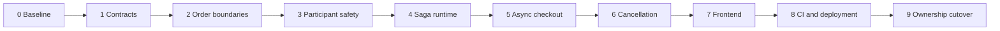

# Saga Service extraction implementation plan

Date: 2026-11-05

Build `checkout-saga-service` as a Spring Boot application that coordinates checkout and full-order cancellation. It owns workflow state in `saga_db`, receives durable Order requests through Kafka, and calls participants through gRPC. Order retains ownership of business order state. Payment and email retain their existing mock providers.

This plan sequences small, reviewable changes and links each step to [the test design](../test-artifacts/test-design/saga-service-extraction-test-design-2026-11-05.md). Existing completed BMAD stories remain unchanged; these steps describe new maintenance work.

## Current implementation and constraints

- [OrderService](../../backend/order-service/src/main/java/com/robomart/order/service/OrderService.java) creates an order and runs the embedded Saga synchronously. Its creation transaction does not currently enqueue an external workflow request.
- [OrderSagaOrchestrator](../../backend/order-service/src/main/java/com/robomart/order/saga/OrderSagaOrchestrator.java) writes Order, history, audit and outbox through Order repositories. Its conditional transitions protect checkout, cancellation and recovery from concurrent actors.
- [PendingPaymentRecoveryService](../../backend/order-service/src/main/java/com/robomart/order/service/PendingPaymentRecoveryService.java) holds an Order row lock across its bounded payment RPC. [SagaRecoveryPolicy](../../backend/order-service/src/main/java/com/robomart/order/saga/SagaRecoveryPolicy.java) also relies on Order rows and a foreign key into `orders`. These transactions cannot move unchanged to a different database.
- [InventoryService](../../backend/inventory-service/src/main/java/com/robomart/inventory/service/InventoryService.java) already persists a RELEASED tombstone when release precedes reserve. It rejects late reserve after release and restores reserved or committed stock once. Reuse and verify this behavior.
- [PaymentService](../../backend/payment-service/src/main/java/com/robomart/payment/service/PaymentService.java), [PaymentIntentStore](../../backend/payment-service/src/main/java/com/robomart/payment/service/PaymentIntentStore.java) and [MockGatewayLedger](../../backend/payment-service/src/main/java/com/robomart/payment/service/MockGatewayLedger.java) already provide committed intents, fenced result writes and durable provider receipts. They do not yet expose the terminal close and reconciliation protocol required for asynchronous cancellation.
- Existing [payment protobuf](../../backend/proto/src/main/proto/payment_service.proto) exposes charge/refund; [Order protobuf](../../backend/proto/src/main/proto/order_service.proto) exposes create/get/cancel. Add dedicated participant commands instead of calling public CreateOrder/CancelOrder recursively from Saga.
- [Order outbox publisher](../../backend/order-service/src/main/java/com/robomart/order/service/OutboxPollingService.java) currently publishes status-changed/cancelled events. The existence of an OrderCreated Avro schema does not enqueue checkout. New orchestration requests need an explicit producer mapping and atomic creation write.
- The local [checkout browser recovery baseline](../test-artifacts/checkout-browser-recovery-2026-11-05.json) includes server-cart acknowledgement, stable checkout retries and protected deep links. Preserve it as a separate reviewed baseline before extraction. Its artifacts establish local validation, not a merged release.

## Architecture decisions

| Concern               | Decision                                                                                                                                                                                                                                                                                                              |
| --------------------- | --------------------------------------------------------------------------------------------------------------------------------------------------------------------------------------------------------------------------------------------------------------------------------------------------------------------- |
| Runtime               | One domain-specific `checkout-saga-service`; no generic workflow DSL or Temporal migration in this scope.                                                                                                                                                                                                             |
| Request ingress       | Order writes a new request to its outbox in the same transaction as order creation or cancellation admission. Kafka delivers it to Saga.                                                                                                                                                                              |
| Participant transport | Existing Inventory/Payment gRPC plus a new authenticated Order participant gRPC service.                                                                                                                                                                                                                              |
| Saga persistence      | Separate database and credentials. A local PostgreSQL instance can host multiple separately owned databases. No Saga queries against Order/Payment/Inventory tables.                                                                                                                                                  |
| Business state        | Order owns PENDING, CONFIRMED, CANCELLATION_PENDING, CANCELLED, SHIPPED and DELIVERED for external orchestration. Legacy technical statuses remain readable during migration.                                                                                                                                         |
| Technical state       | Saga owns reserve/payment uncertainty, retries, compensation, deadlines and manual review. The customer can see generic PENDING while checkout progresses.                                                                                                                                                            |
| Workflow lifetime     | One durable Saga identity per externally owned order. CHECKOUT_CONFIRMED is quiescent and remains able to receive cancellation later. It is not an instruction to delete the workflow record.                                                                                                                         |
| Stock lifecycle       | Preserve existing `order.order.status-changed` and `order.order.cancelled` Avro events and their Inventory consumers. Order still emits confirmation/cancellation events.                                                                                                                                             |
| Public API            | New external checkout and pending replays return 202 with orderId/current status. A settled same-key replay returns 200 with the original order. Cancellation returns 202 while pending and 200 for a replayed final cancellation; shipping/delivery conflicts remain 409. Public gRPC also returns the actual state. |
| Cart policy           | Retain the saved checkout and cart snapshot while pending. Consume the snapshot after CONFIRMED, SHIPPED or DELIVERED; preserve it for cancellation/failure. A 202 or PAYMENT_PENDING alone does not clear the cart.                                                                                                  |
| Migration             | Persist engine ownership on each Order. New external orders and legacy orders have disjoint writers and recovery workers. No automatic re-execution of historical checkout.                                                                                                                                           |

### Identities and durable bindings

- Keep the existing stable charge identity based on orderId; never replace it with a worker, lease, retry-attempt or process ID.
- Assign sagaId once at Order creation and persist it with `orchestrator_owner` and `orchestrator_epoch`.
- Generate deterministic start/cancel request identities and stable Order command IDs for each logical transition. Repeated cancellation must not create a new refund identity or reset retry budgets.
- Persist an immutable priced Order snapshot with product IDs, quantities, total, currency and snapshot version/hash. Saga does not reprice against Product. Shipping/card details do not belong in workflow messages.
- Bind an idempotency key to its canonical request. Client-supplied product names/prices are ignored by current Order pricing and must not become authoritative fingerprint inputs. Preserve replay compatibility for old orders without the new fingerprint.

### Durable requests and participant commands

Use one versioned control topic, initially `order.checkout.requests.v1`, keyed by orderId, with one Avro envelope and requestType START or CANCEL. Include eventId, requestId, requestSequence, orderId, sagaId, owner epoch, workflow version and the immutable context needed to recover. Persist sequence allocation with the Order/outbox transaction. A single envelope avoids introducing incompatible Avro record names under the default topic schema strategy.

Keep requestSequence distinct from aggregate optimistic-lock version. Inbox deduplication, payload binding and cancellation handling must remain correct if CANCEL is observed before START, or old messages arrive after newer ones.

| Participant | Proposed contract                                                                                                                     | Required semantics                                                                                                                                                                                                                               |
| ----------- | ------------------------------------------------------------------------------------------------------------------------------------- | ------------------------------------------------------------------------------------------------------------------------------------------------------------------------------------------------------------------------------------------------ |
| Order       | GetCheckoutSnapshot, ConfirmCheckout, BeginCancellation, FinalizeCancellation, GetCommandResult                                       | Commands carry commandId, payload hash, orderId, sagaId, owner epoch and state/version preconditions. Receipt, business mutation, history and outbox commit atomically. Replays return the recorded result even if the Order has since advanced. |
| Inventory   | Existing ReserveInventory and ReleaseInventory; add a reservation lookup only if reconciliation needs it                              | Preserve orderId idempotency, validate replayed line bindings, and preserve terminal release tombstones. Reserve cannot resurrect a released reservation.                                                                                        |
| Payment     | GetChargeOutcome, CloseCharge, GetRefundOutcome, existing ProcessPayment/RefundPayment or a narrowly scoped full-cancellation adapter | Return explicit durable outcomes, stable payment/refund references and amounts. NOT_FOUND and a transient local FAILED flag do not prove no charge.                                                                                              |

Order public cancellation and the new internal BeginCancellation operation use the same admission logic. Both must race safely against ConfirmCheckout and shipping. A replay after a successful confirmation must return the original confirmation receipt, not trigger compensation because current state is now SHIPPED.

### Payment closure is a prerequisite

Define charge outcomes such as SUCCEEDED, DECLINED_FINAL, NO_CHARGE_FINAL, IN_PROGRESS and UNKNOWN. `NO_CHARGE_FINAL` is valid only when a terminal gate prevents every delayed charge request for that order, including a caller paused after intent acquisition.

Implement closure at Payment admission and at the durable mock provider boundary. Use the provider's existing order-binding lock to serialize settlement with a terminal close receipt or separate close record. If close wins, a stale dispatch cannot settle later. If settlement wins, closure returns the durable charge result. If the result cannot be established within the RPC deadline, return UNKNOWN and keep stock held. Do not hold an application connection/transaction while waiting for provider I/O.

A provider receipt may exist before the application finalizer records its result. Reconciliation must safely repair/read the application outcome from the provider receipt with fencing. It must distinguish provider-declared decline from a temporary application failure.

Cancellation refunds use a stable operation identity. Resolve existing refunded amounts and allocate the remaining amount under Payment's existing concurrency controls; persist that operation amount before provider dispatch. Retries reuse that amount/key. Preserve all current partial-refund and currency invariants. A refund failure or unknown result blocks inventory release and final cancellation.

## Implementation sequence

The exit criteria below gate progression to the next dependent step. They are checks on code and runtime behavior, not instructions to deploy a partially completed coordinator.

### Step 0 preserve the browser recovery baseline

Deliver the current checkout/cart/auth changes as an independent reviewable baseline, including the Playwright workflow. Record the exact source used for extraction tests and preserve unrelated local documents and images. Establish repeatable test commands before changing checkout response semantics.

Exit: the baseline's unit, integration, coverage, browser and isolated E2E checks are reproducible. Test reference: G00. No existing story is reopened automatically.

### Step 1 define states contracts and invariants

Write the architecture decision alongside contract changes. Finalize public status mapping, charge close semantics, stable identities, workflow ownership, event envelope, command receipt responses and per-phase recovery budgets. Define CHECKOUT_CONFIRMED as waiting for possible later cancellation.

Pin workflow version per instance. Later releases must retain compatible handlers or explicitly migrate a verified checkpoint; changing step names or compensation rules must not re-execute already completed operations.

Specify permitted transitions and the priority of a persisted cancellation intent. Confirming and accepting cancellation compete atomically in Order; shipping cannot pass CANCELLATION_PENDING. Refund must precede stock return for a charged order. Unknown charge/refund never becomes an automatic release.

Exit: the contract/state test fixtures cover every failure and cancellation branch in the agreed sequence diagrams. Test references: C01-C06. These fixtures initially test the state rules and wire contracts; they are not evidence of running a new service.

### Step 2 establish boundaries inside Order

Replace entity-carrying SagaContext dependencies with immutable workflow data and explicit ports for Order transitions, participant calls and workflow persistence. Keep embedded behavior working through local adapters. Do not copy Order JPA entities/repositories into a shared Saga module.

Introduce additive Order migrations for owner, epoch, saga ID, request sequence/fingerprint and command receipts. Add the Order participant service with transactional command deduplication and state/version guards. Keep business history/outbox in Order. Define a scoped service authentication interceptor for new gRPC contracts rather than globally enabling security on existing gRPC services whose auto-security is deliberately excluded.

Apply owner/epoch conditions to final database writes as well as recovery query filters. A legacy worker selected before a handover must not be able to overwrite the new owner's state afterward.

Exit: existing embedded Order tests still pass; command replay, ownership and cancel/ship races pass against real PostgreSQL and authenticated RPC. Test references: O01-O07, S01-S03.

### Step 3 make participants safe for asynchronous cancellation

Add Payment outcome lookup and terminal close, including the provider-side close/settlement serialization described above. Add refund reconciliation and durable amount/key binding. Supply backward-compatible protobuf additions; retain existing charge/refund entry points for legacy orders.

Deploy only compatible Payment/provider writers before relying on the new closure semantics. An older settlement implementation that ignores a new close record can invalidate NO_CHARGE_FINAL even if every new Saga worker is fenced.

Reuse Inventory release tombstones. Verify absent reservation, concurrent reserve/release, committed-stock return and late lifecycle events. Reject reserve replays that bind the same orderId to different lines; derive compatibility behavior from stored lines for legacy reservations.

Exit: a deterministic test pauses charge after application intent acquisition, closes it, then resumes that old caller without producing a charge; the inverse settlement-first race reports payment success and compensates exactly once. This gate must pass before enabling external checkout. Test references: P01-P09, I01-I05.

### Step 4 bootstrap the Saga runtime and infrastructure

Add `checkout-saga-service` to the Maven reactor, shared image renderer, source/prebuilt Docker targets and isolated Compose stack. Provide private health/metrics and authenticated operator endpoints; no public customer workflow-control API. Assign ports after checking all host/container allocations.

Add its Backend CI integration/coverage entry as soon as the module exists. Provision the isolated Saga database role and Keycloak service identity for new and retained fixtures idempotently; do not rely only on initialization scripts that run against empty volumes. Preserve existing users, secrets and databases.

Create service-owned Flyway migrations for `saga_instances`, `saga_steps`, `saga_inbox` and persistent scheduled work. Use orderId uniqueness for workflow admission, unique logical step/operation identities, and inbox uniqueness for event/request identity. Persist cancellation stubs when CANCEL arrives before START.

Receive an event by committing inbox/workflow/work scheduling together, then ACK Kafka. Workers claim due work with short PostgreSQL transactions and a lease/fencing token. RPC runs outside the transaction; result/next-step writes require the current token. A stale worker cannot overwrite newer progress. Lease fencing does not replace participant idempotency and terminal-state checks.

Preserve deadlines, bounded participant retries, circuit-breaker classification and correlation/trace propagation. Persist budgets/deadlines so restart or replica takeover does not grant a fresh budget. Apply bounded retry/manual-review policy to reserve, charge, refund, release and Order finalization.

Exit: runtime is healthy with business dispatch disabled by default; two workers, database rollback, inbox redelivery, lease expiry and small-pool tests pass. Test references: W01-W09.

### Step 5 enable asynchronous checkout in the isolated stack

For EXTERNAL orders, Order creation atomically writes PENDING, the priced snapshot, owner binding and START outbox request. Return 202 after commit, even if Saga/Kafka is temporarily unavailable. Existing same-key retries return that original order without another start event. Invalid input/auth/pricing failure must not create an Order or workflow request.

Implement Reserve -> Charge -> ConfirmCheckout, persisting each outcome and next action. A reserve business rejection ends checkout without charge. A reserve/charge timeout enters uncertainty recovery. A charge decline enters cancellation/compensation. Failed Order finalization stays retryable with its command identity; only a definitive cancellation conflict diverts into compensation.

Implement the common compensation runner required by checkout failure, including charge resolution, refund when necessary, release and finalization. Step 6 adds the complete customer cancellation lifecycle and operator recovery. Keep external admission disabled for ordinary user traffic while this vertical slice is incomplete.

Order keeps publishing its existing status/cancellation events after accepted business transitions. Inventory commits reservations through the retained event path. Do not add a second unfenced commit actor.

Exit: X01-X07 checkout component/integration scenarios pass, including compensation decisions against controlled participant boundaries. The full-stack cancellation and cleanup gate follows Step 6; an incomplete Step 5 is not a user-facing cutover.

### Step 6 implement cancellation compensation and operator recovery

Order admits cancellation with an atomic state/version change to CANCELLATION_PENDING and a CANCEL outbox request. Repeat requests return the existing cancellation state. Authentication and ownership checks remain at Order.

Saga persists cancellation intent before dispatching further work. Resolve/close charge; if charged, confirm refund; release or close Inventory; then retry FinalizeCancellation until Order acknowledges. Persist REFUND_SUCCEEDED and RELEASE_SUCCEEDED so later failures do not replay completed business operations with new identities.

Support cancel before START, during reserve/charge uncertainty, after payment but before confirmation, and after CHECKOUT_CONFIRMED. The quiescent workflow must wake for later cancellation. Unresolved compensation reaches authenticated manual review while Order remains pending cancellation and stock remains protected. Resume preserves original identities and records the operator action.

Exit: all cancellation timing, refund/release failure, terminal close, finalization replay and operator-access tests pass. Run the complete isolated checkout/cancellation/fault gate with real participants. Test references: K01-K08, R01-R04, E01-E06.

### Step 7 adapt Customer Admin and browser tests

Render PENDING and CANCELLATION_PENDING accurately; do not fall through to Order Confirmed. Preserve all legacy statuses, including REFUND_FAILED, in types, tables, filters and shared state components. Pending order creation and pending cancellation are accepted requests, not completed purchases/refunds.

Save orderId as soon as 202 arrives. Poll the existing Order read endpoint with bounded intervals/backoff and stop on unmount or a settled business outcome; keep the saved checkout for reload. Order reads must not require Saga availability. Avoid persistent fast polling that exhausts Gateway rate limits.

Matching confirmation/detail views restore the saved attempt and resume pending cart acknowledgement when the order settles. Keep the existing sessionStorage lifetime limitation explicit: closing/clearing the browser session loses that client recovery record. This scope does not introduce cross-device retry identity or an additional server-driven Cart workflow.

Update cart acknowledgement to clear only confirmed purchases and only their saved line snapshot. Preserve the cart on cancellation; retain retry state if cleanup fails. Preserve the previously fixed OIDC deep links and checkout key/payload binding. A user returning after checkout confirmation can still request cancellation.

Make REST and public Order gRPC responses expose the actual current state. The current gRPC cancellation implementation's unconditional CANCELLED response must not survive asynchronous routing.

Exit: browser tests await outcomes through 202 and cover delayed confirmation, eventual cancellation, unknown outcomes, reload, later cart additions and unavailable cleanup. Test references: B01-B07, C06.

### Step 8 integrate CI security deployment and observability

Complete the Saga module's CI integration and extend the E2E stack with health ordering, ownership-checked fault commands and measured Docker memory allocations. The module's integration/coverage entry and fixture identity/database provisioning start in Step 4. Run browser and Java chaos suites sequentially.

Update the image renderer and generated outputs, CD backend image matrix, `release-policy.cjs` expected service/image sets and their regression tests together. The release would require eight backend images and two frontend images; missing/foreign/stale Saga provenance must fail publication. Preserve digest pinning and exact-source release behavior.

Add K8s Deployment/Service, database Secret references, service identity/audience checks, NetworkPolicies, scrape target and operator routing/RBAC. Allow Saga to reach participant gRPC ports and new participant methods; keep legacy callers permitted only while their owned workflows require them. Do not expose bare participant control ports publicly.

Update the Admin health registry/client configuration and operator views so the new service appears in health reporting without making normal Order reads depend on its availability. Update development architecture, run commands and service/port documentation alongside the final implementation.

Track due-work lag, workflow state counts, unknown outcomes, retries, expired claims, compensation backlog and manual reviews. Carry orderId/sagaId/commandId in structured logs/traces; avoid high-cardinality IDs as metric labels and avoid sensitive payload logging.

Exit: clean package/render checks, module coverage, release-policy tests, private endpoint/RBAC tests and isolated E2E pass. Hosted CI and deployment validation remain separate execution steps. Test references: S01-S04, D01-D04, E05-E08.

### Step 9 cut over ownership and retire embedded orchestration

Roll out additive schemas/participant compatibility first. Route new test orders to EXTERNAL and persist that decision per Order. Filter every embedded checkout, cancellation, pending-payment scan and dead-saga scan to EMBEDDED owners; external commands must verify owner/epoch. A mutable global flag is not sufficient ownership fencing.

Keep legacy CONFIRMED orders cancellable through their existing engine until their business lifecycle finishes, or explicitly adopt them using a reconciled snapshot and epoch change. Do not re-run checkout to adopt an already-paid order. Do not retire legacy code merely because in-flight payment count is zero.

For stuck legacy workflows, finish or explicitly hand over each one using participant receipts, original keys, phase budgets and a new fenced owner epoch. Keep historical migrations/audit rows; move active state through an explicit checkpointed migration if required. Do not copy tables with cross-database foreign keys or mutate applied migrations.

Rollback routes future new orders to the embedded owner while EXTERNAL orders remain with a compatible external worker. Reverting binaries or changing a global flag must not give both engines the same Order. Retire embedded code only after no remaining legacy workflow/cancellable order needs it.

Exit: mixed ownership, adoption, rollback and delayed legacy-worker tests pass; every Order has one authorized coordinator; historical orders still read correctly. Test references: M01-M06.

## Dependency order



Service scaffolding can be prepared earlier with dispatch disabled, but external workflows must remain disabled until participant closure, Order command fencing and durable worker tests pass.

## Verification commands during implementation

Run module installation before verification. Commands below describe the future implementation checks; the new service module must exist before using its selector.

```bash
# From backend: package reactor dependencies without executing tests.
./mvnw install -pl :checkout-saga-service,:order-service,:inventory-service,:payment-service -am -DskipTests -DskipITs -DskipE2ETests

# From backend: verify owning modules with real integration tests and coverage.
./mvnw verify -pl :proto,:events,:checkout-saga-service,:order-service,:inventory-service,:payment-service -DskipE2ETests

# From frontend.
npm run type-check --workspaces --if-present
npm run test:unit --workspaces --if-present -- --run
npm run build --workspaces --if-present

# From repository root after packaging: build/start the isolated stack.
infra/e2e/stack.sh build
infra/e2e/stack.sh up

# Run these sequentially. Java chaos stops participant/Saga containers.
# From frontend:
npm run test:e2e --workspace=customer-website
# From repository root:
infra/e2e/stack.sh test
infra/e2e/stack.sh down
```

Also run schema compatibility, read-only lint/format checks, Dockerfile renderer drift checks, affected manifest rendering, release-policy tests and `git diff --check`. Verify modules individually when Testcontainers resource contention makes a combined local invocation unreliable. Never skip integration tests or disable the 80 percent coverage gate while claiming those checks passed.

## Completion criteria

- Order creation and workflow admission are durable across Order/Saga/Kafka outages and client retry.
- A successful order has exactly one provider charge, one reservation effect and one confirmation history/outbox effect. A charge-free failure has no provider charge.
- A cancelled charged order has a confirmed refund of its charged amount, restored stock once and one accepted cancellation transition.
- Unknown charge/refund cannot release stock or become a final cancellation; manual review does not weaken this invariant.
- Cancellation wins safely against late START, reserve, charge, confirmation and shipping. A confirmed checkout remains cancellable later.
- Customer reads and UI retain correct pending states, saved retry context, deep links and cart acknowledgement behavior.
- Mixed engine ownership and rollback cannot dispatch conflicting work; deployment provenance includes the new service.

## Design references

Each participating service keeps its own local transaction; cross-service coordination still needs idempotency, semantic state guards and durable compensation. See [AWS Saga orchestration](https://docs.aws.amazon.com/prescriptive-guidance/latest/cloud-design-patterns/saga-orchestration.html).

Atomic Order/outbox writes and idempotent delivery address the database/message dual-write gap. See [AWS Transactional outbox](https://docs.aws.amazon.com/prescriptive-guidance/latest/cloud-design-patterns/transactional-outbox.html).

## Implementation decisions — 2026-11-09

- Implemented as a dedicated Boot application with JDBC/Flyway, one START/CANCEL Avro topic, durable inbox/workflow/operation intents, short SKIP LOCKED leases and token-fenced progress.
- Participant circuit breakers isolate transport outages (five failures, 30-second open interval, one recovery probe). Business rejections keep their existing meanings; breaker denial defers the persisted phase without compensation or a new budget. Each dispatch has one bounded RPC rather than nested retry loops.
- Order owns business transitions and transactionally persists command receipts/history/outbox. Confirm replay returns its original receipt even after shipping. Participant outcomes use an explicit string vocabulary; unspecified/unrecognized values remain unresolved and cannot authorize release.
- Mock provider closure is durable and serialized under the same order lock as actual settlement. Positive charge/refund receipts repair stalled application finalizers. Cancellation refunds allocate only the remaining amount under the existing payment lock.
- Existing Inventory terminal tombstones/commit/return semantics are retained; replay additionally validates stored product/quantity bindings.
- New internal Order/Payment RPCs require the signed Saga client identity. Existing internal RPCs remain compatible under network restrictions. The Saga DB role has no participant DB connection privilege in the retained E2E fixture.
- New admissions are EXTERNAL only when explicitly enabled. Embedded workflows/history remain compatible; quiescent confirmed legacy orders have an explicit audited epoch-increasing adoption path. Rollback does not reassign existing external orders.
- Customer polling, persisted retry context and deferred cart consumption handle eventual outcomes. Cancellation stays pending through unresolved financial/inventory work. The shared/Admin UI includes new and retained legacy statuses.
- Packaging, CI module coverage, serial browser/Java fault suites, eight-image release policy, Compose/Kubernetes, scoped identity, health/metrics and operator endpoints include the new service. Live infrastructure and the next real release digest remain deployment inputs; previous provenance is preserved.

Local execution evidence is recorded separately under `test-artifacts`; the original scenario matrix remains a statement of obligations. Hosted CI and production rollout must not be reported as local test results.

Local validation (2026-11-09): [execution evidence](../test-artifacts/saga-service-extraction-2026-11-09.json) records 15 backend E2E tests, 7 browser tests, module coverage and fixture teardown. Hosted CI and production rollout are recorded separately.
