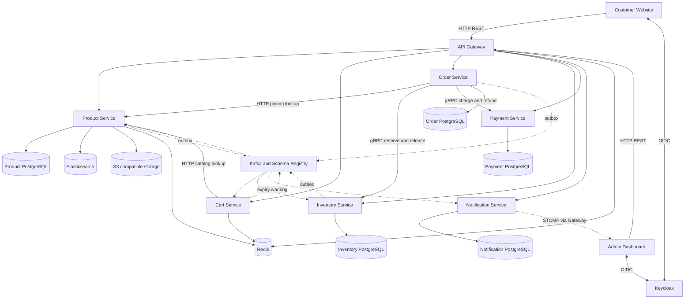
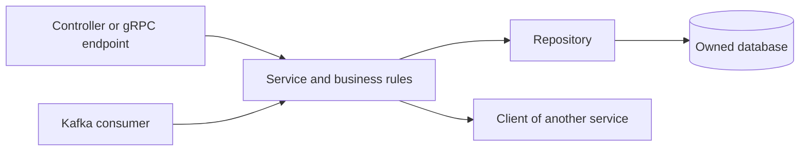
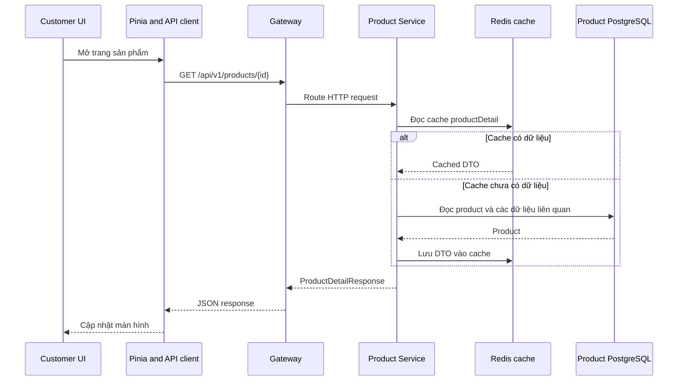
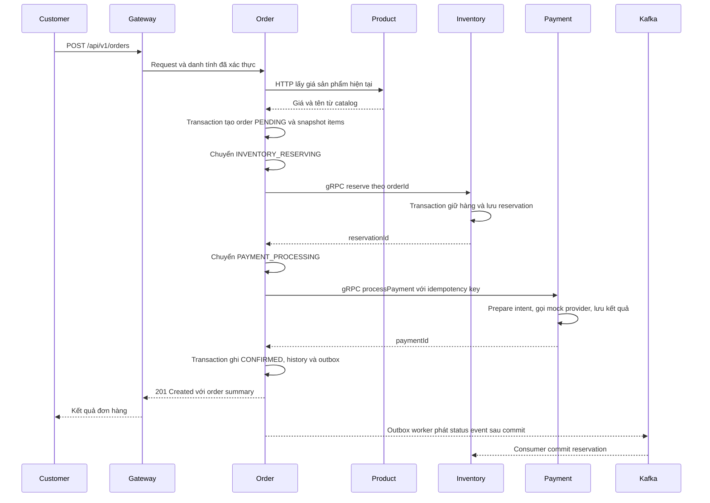
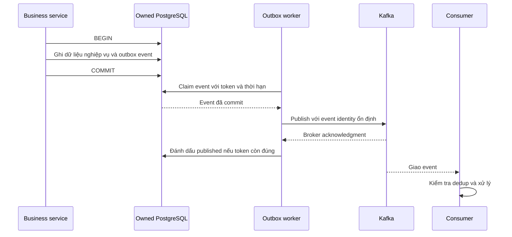
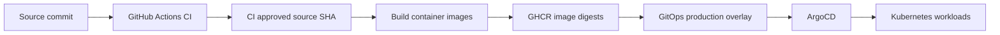

# Hướng dẫn học kiến trúc Robo-Mart

Robo-Mart là hệ thống thương mại điện tử gồm website khách hàng, dashboard quản trị và backend microservices. Một thao tác như đặt hàng đi qua nhiều service, mỗi service sở hữu dữ liệu riêng. Vì vậy, học project này là học cách chia trách nhiệm, truyền dữ liệu và giữ nghiệp vụ đúng khi một phần hệ thống gặp lỗi.

Bản hướng dẫn dành cho người đã biết cơ bản HTTP, Java/Spring và Vue. Đọc theo thứ tự từ tổng quan đến checkout, sau đó mở các file được dẫn để nối khái niệm với implementation. Sau khi học, bạn nên tự vẽ lại được luồng mua hàng và giải thích vì sao hệ thống cần Saga, Outbox và idempotency.

Phạm vi là mã nguồn và cấu hình của checkout repository ngày 30/10/2026. Các ví dụ số lượng và tình huống bên dưới phục vụ việc học. Cấu hình triển khai mô tả cách hệ thống được thiết lập, không xác nhận trạng thái của một cluster đang chạy.

## Mục lục

1. [Bức tranh tổng thể](#bức-tranh-tổng-thể)
2. [Trách nhiệm và quyền sở hữu dữ liệu](#trách-nhiệm-và-quyền-sở-hữu-dữ-liệu)
3. [Bản đồ mã nguồn và các lớp bên trong service](#bản-đồ-mã-nguồn-và-các-lớp-bên-trong-service)
4. [Đọc một request từ giao diện xuống database](#đọc-một-request-từ-giao-diện-xuống-database)
5. [Đăng nhập và ranh giới tin cậy](#đăng-nhập-và-ranh-giới-tin-cậy)
6. [Checkout và Saga](#checkout-và-saga)
7. [Tồn kho và các request đồng thời](#tồn-kho-và-các-request-đồng-thời)
8. [Outbox và luồng sự kiện](#outbox-và-luồng-sự-kiện)
9. [Frontend và trạng thái hiển thị](#frontend-và-trạng-thái-hiển-thị)
10. [Môi trường chạy và quy trình triển khai](#môi-trường-chạy-và-quy-trình-triển-khai)
11. [Lộ trình học và thực hành](#lộ-trình-học-và-thực-hành)
12. [Câu hỏi tự kiểm tra](#câu-hỏi-tự-kiểm-tra)

## Bức tranh tổng thể

Hãy hình dung Robo-Mart như một cửa hàng có nhiều bộ phận: Product quản lý mặt hàng và giá, Cart giữ giỏ hàng, Order điều phối đơn, Inventory giữ hàng, Payment xử lý thanh toán và Notification thông báo kết quả. API Gateway là cửa vào HTTP chung cho hai ứng dụng frontend. Keycloak quản lý danh tính.



Các mũi tên nét liền biểu diễn đường gọi trực tiếp hoặc truy cập dữ liệu; nét đứt biểu diễn đường sự kiện và thông báo. Sơ đồ lược bớt các HTTP call phục vụ health, đối soát và bổ sung nội dung notification để dễ đọc.

### Công nghệ hiện tại

| Phần       | Công nghệ và vai trò                                                           |
| ---------- | ------------------------------------------------------------------------------ |
| Backend    | Java 25, Spring Boot 4.1.2, Spring Cloud 2025.1.4; Maven multimodule           |
| Frontend   | Vue 3, TypeScript, Vue Router, Pinia, PrimeVue, Tailwind, Vite; npm workspaces |
| API ngoài  | REST; Product còn cung cấp GraphQL tại `/graphql`                              |
| API nội bộ | gRPC cho Order gọi Inventory và Payment; HTTP cho một số truy vấn giữa service |
| Dữ liệu    | PostgreSQL, Redis, Elasticsearch và S3-compatible object storage               |
| Sự kiện    | Kafka, Avro và Schema Registry                                                 |
| Danh tính  | Keycloak, OIDC, JWT và role `ADMIN`                                            |
| Hạ tầng    | Docker Compose khi phát triển; Kubernetes, Kustomize, ArgoCD cho GitOps        |

Version backend ở đây lấy từ [backend/pom.xml](../backend/pom.xml). Một số tài liệu cũ và `AGENTS.md` vẫn ghi Java 21 / Boot 4.0.4; Maven hiện yêu cầu Java từ 25 đến trước 26. Cấu hình frontend nằm trong [customer package.json](../frontend/customer-website/package.json) và [admin package.json](../frontend/admin-dashboard/package.json).

### Chọn cách giao tiếp theo nhu cầu

| Cách giao tiếp             | Ví dụ trong Robo-Mart                     | Điều cần hiểu                                                                       |
| -------------------------- | ----------------------------------------- | ----------------------------------------------------------------------------------- |
| HTTP REST                  | Browser tạo đơn; Order lấy giá từ Product | Caller chờ response; có thể timeout dù bên nhận đã xử lý                            |
| GraphQL                    | API truy vấn Product                      | Client chọn các trường cần lấy; API có sẵn không có nghĩa mọi màn hình đều dùng nó  |
| gRPC                       | Order reserve hàng và process payment     | Contract Protobuf có kiểu rõ ràng; vẫn là lời gọi mạng có thể thất bại              |
| Kafka                      | Order phát sự kiện đổi trạng thái         | Producer và consumer xử lý tách thời điểm; consumer có thể nhận lại event           |
| STOMP qua WebSocket/SockJS | Admin nhận live event                     | Cập nhật giao diện khi đang kết nối; lịch sử nghiệp vụ vẫn phải tra từ API/database |

Gateway hiện định tuyến HTTP đến service. Phần điều phối checkout và gọi gRPC nằm trong Order, dù tài liệu thiết kế ban đầu có đề cập REST-to-gRPC tại Gateway.

## Trách nhiệm và quyền sở hữu dữ liệu

**Data ownership** nghĩa là service sở hữu quy tắc và quyền ghi dữ liệu của domain mình. Ví dụ, Order yêu cầu Inventory giữ hàng qua API, thay vì sửa thẳng bảng tồn kho.

| Thành phần   | Chịu trách nhiệm                                                | Dữ liệu sở hữu hoặc sử dụng                                                                      |
| ------------ | --------------------------------------------------------------- | ------------------------------------------------------------------------------------------------ |
| API Gateway  | Routing, JWT/RBAC, relay danh tính, rate limit, circuit breaker | Redis cho rate limit; không sở hữu đơn hàng                                                      |
| Product      | Catalog, category, giá, ảnh, tìm kiếm                           | PostgreSQL là dữ liệu gốc; Elasticsearch là search projection; Redis là cache; S3 chứa bytes ảnh |
| Cart         | Thêm/sửa/xóa item, guest cart, merge sau đăng nhập, hết hạn     | Redis là nơi lưu giỏ hàng, TTL mặc định 1.440 phút                                               |
| Order        | Tạo đơn, snapshot giá, trạng thái, Saga, hủy đơn, báo cáo       | PostgreSQL lưu order, item, history, Saga audit và outbox                                        |
| Inventory    | Số lượng tồn, reservation, nhập kho, commit/release             | PostgreSQL lưu inventory, reservation, dòng hàng, stock movement và outbox                       |
| Payment      | Charge/refund, chống xử lý lặp                                  | PostgreSQL lưu payment, intent, idempotency; provider hiện là mock                               |
| Notification | Notification log, admin feed, DLQ, health và đối soát           | PostgreSQL lưu log, dedup và dữ liệu vận hành                                                    |
| Keycloak     | Đăng nhập và phát token                                         | Database riêng cho danh tính; frontend không tự phát JWT                                         |

Một `productId` trong Order hoặc Inventory là tham chiếu nghiệp vụ. Nó không tạo foreign key xuyên qua database của Product. Order lưu snapshot tên và giá tại thời điểm đặt hàng, nên việc Product đổi giá sau đó không làm thay đổi tổng tiền đơn cũ.

### Vì sao có nhiều loại nơi lưu dữ liệu

- **PostgreSQL** giữ dữ liệu nghiệp vụ cần transaction và ràng buộc. Ví dụ, không thể giữ nửa giỏ hàng rồi coi reservation là thành công toàn bộ.
- **Redis cache của Product** giảm số lần đọc dữ liệu gốc. **Redis của Cart** giữ chính nội dung giỏ hàng; mất Redis có ảnh hưởng khác với mất một bản cache sản phẩm.
- **Elasticsearch projection** là bản biểu diễn sản phẩm phục vụ search. Nó được cập nhật từ sự kiện và có thể chậm hơn PostgreSQL.
- **Object storage** chứa file ảnh; PostgreSQL giữ metadata và thứ tự ảnh. URL ảnh mới trỏ đến địa chỉ public bucket/CDN được cấu hình; đường `/images/**` hỗ trợ URL cũ qua redirect.

Sự phân chia này giúp mỗi phần phục vụ kiểu truy cập riêng, đồng thời làm xuất hiện bài toán đồng bộ nhiều nơi lưu trữ. Đây là lý do cần học eventual consistency: dữ liệu gốc đã đổi nhưng bản search hoặc cache có thể chưa phản ánh ngay.

Đọc thêm: [ProductService](../backend/product-service/src/main/java/com/robomart/product/service/ProductService.java), [Cart configuration](../backend/cart-service/src/main/resources/application.yml), [ImageStorageService](../backend/product-service/src/main/java/com/robomart/product/service/ImageStorageService.java) và [hướng dẫn object storage](product-object-storage.md).

## Bản đồ mã nguồn và các lớp bên trong service

```text
backend/
  pom.xml                  Version, reactor modules, quality gates
  product-service/         Catalog và search
  cart-service/            Giỏ hàng Redis
  order-service/           Đơn hàng và Saga
  inventory-service/       Tồn kho và reservation
  payment-service/         Payment và refund
  notification-service/    Notification và công cụ vận hành
  api-gateway/             Cửa vào HTTP
  common-core/             DTO, exception, audit contract, kiểu dữ liệu nền
  common-web-starter/      Servlet auto-configuration, Jackson, error handling, audit
  common-lib/              Compatibility facade của common-web-starter
  outbox-lib/              Claim, dispatch và retention dùng chung
  security-lib/            JWT validation và chuyển đổi Keycloak roles
  proto/                   Nguồn hợp đồng gRPC
  events/                  Nguồn schema Avro
  test-support/            Fixtures, Testcontainers và ArchUnit rules
  e2e-tests/               Test cần stack tích hợp
frontend/
  customer-website/        Ứng dụng khách hàng
  admin-dashboard/        Ứng dụng quản trị
  shared/                 Components, themes và design tokens dùng chung
infra/
  docker/                 Compose và Dockerfiles
  k8s/                    Base, overlays, ArgoCD và monitoring
  ci/                     Scripts hỗ trợ CI và release policy
.github/workflows/        Pipeline CI/CD
```

Đây là **monorepo chứa nhiều ứng dụng**. Maven module có thể là service chạy độc lập hoặc thư viện được đóng gói vào service khác. `proto`, `events`, `common-core` không phải các server cần khởi động riêng.

### Cấu trúc thường gặp trong một service



| Lớp hoặc thư mục            | Đọc để trả lời câu hỏi                                                          |
| --------------------------- | ------------------------------------------------------------------------------- |
| `controller`, `web`, `grpc` | Endpoint nhận gì, danh tính lấy ở đâu, trả status gì?                           |
| `service`, `saga`           | Quy tắc nghiệp vụ và thứ tự xử lý là gì? Transaction bắt đầu/kết thúc ở đâu?    |
| `repository`, `entity`      | Dữ liệu lưu thế nào? Có unique constraint, version hoặc conditional update nào? |
| `client`, `event`           | Service phụ thuộc ai? Gửi/nhận contract nào?                                    |
| `config`, `application.yml` | URL, port, security, timeout và tính năng bật theo profile nào?                 |
| `db/migration`              | Schema và constraint đã thay đổi qua các Flyway migration nào?                  |
| `src/test`                  | Hành vi khi thành công, lỗi, retry và chạy đồng thời được kỳ vọng ra sao?       |

Project dùng layered architecture ở nhiều service, kết hợp các thành phần chuyên biệt cho Saga và messaging. Khi đọc code, theo call chain thực tế; tên package chưa đủ để kết luận toàn bộ project áp dụng Clean Architecture hay DDD một cách đầy đủ.

Các [ArchUnit rules](../backend/test-support/src/main/java/com/robomart/test/arch/RoboMartArchRules.java) thể hiện một phần ý định phân lớp. Hợp đồng gRPC nằm trong [proto](../backend/proto/src/main/proto/); hợp đồng sự kiện nằm trong [events](../backend/events/). Sửa contract nguồn rồi sinh mã, tránh sửa Java được generate.

## Đọc một request từ giao diện xuống database

Bắt đầu bằng **xem chi tiết sản phẩm**, vì luồng này ngắn hơn checkout.



Trong luồng đọc thông thường này, Product không cần hỏi Order, Payment hay Inventory để hoàn tất response. Đó là một lợi ích của việc giữ trách nhiệm đọc catalog trong Product.

Đọc theo thứ tự:

1. [ProductDetailView.vue](../frontend/customer-website/src/views/ProductDetailView.vue): màn hình cần những dữ liệu nào?
2. [useProductStore.ts](../frontend/customer-website/src/stores/useProductStore.ts) và [productApi.ts](../frontend/customer-website/src/api/productApi.ts): state và HTTP request được tách thế nào?
3. [RouteConfig.java](../backend/api-gateway/src/main/java/com/robomart/gateway/config/RouteConfig.java): path được chuyển sang service nào?
4. [ProductRestController.java](../backend/product-service/src/main/java/com/robomart/product/controller/ProductRestController.java): HTTP được chuyển thành lời gọi nghiệp vụ ra sao?
5. [ProductService.java](../backend/product-service/src/main/java/com/robomart/product/service/ProductService.java): tìm `getProductById` và `@Cacheable`.

Khi chuyển sang tìm kiếm, đọc [ProductSearchService](../backend/product-service/src/main/java/com/robomart/product/service/ProductSearchService.java). Nó dùng Elasticsearch và có PostgreSQL fallback cho những lỗi kết nối được nhận diện; fallback hỗ trợ keyword/category với chức năng lọc hạn chế hơn. Đây là ví dụ về **graceful degradation**: hệ thống vẫn phục vụ được một phần chức năng khi một dependency không khả dụng.

## Đăng nhập và ranh giới tin cậy

**Authentication** xác định caller là ai; **authorization** quyết định caller được làm gì. Customer xem catalog công khai, nhưng tạo đơn cần đăng nhập và đường `/api/v1/admin/**` cần role `ADMIN`.

Luồng chính:

1. Frontend dùng `oidc-client-ts` chuyển người dùng sang Keycloak realm `robomart`, với flow `response_type: code`.
2. Sau callback, frontend giữ trạng thái đăng nhập và gửi access token trong `Authorization: Bearer ...` khi gọi API.
3. Gateway xác thực JWT và áp dụng chính sách endpoint/role.
4. Gateway ghi lại `X-User-Id` từ JWT subject đã xác thực; caller không được tự quyết định user ID qua header.
5. Các resource service có cấu hình security riêng; với Cart, luồng định danh dựa vào header do Gateway relay và ranh giới mạng phải bảo vệ đường gọi trực tiếp.

**Trust boundary** là nơi thay đổi mức độ tin cậy. Dữ liệu từ browser chưa đáng tin chỉ vì nó mang tên `userId` hay `unitPrice`. Vì vậy, Gateway loại bỏ/ghi đè danh tính client gửi, còn Order lấy lại giá từ Product khi đặt hàng.

Guest cart dùng `X-Cart-Id` dạng UUID và namespace tách với user cart. Sau đăng nhập, endpoint merge dùng danh tính đã xác thực để nhập guest cart vào giỏ của user.

WebSocket có bước xác thực riêng: Gateway cho HTTP handshake `/ws/**` đi qua; Notification kiểm tra JWT ở STOMP `CONNECT` và phân quyền destination. Handshake thành công chưa có nghĩa caller được subscribe mọi topic.

Nguồn để đọc: [OIDC configuration](../frontend/customer-website/src/auth/keycloak.ts), [API client](../frontend/customer-website/src/api/client.ts), [GatewaySecurityConfig](../backend/api-gateway/src/main/java/com/robomart/gateway/config/GatewaySecurityConfig.java), [UserIdRelayFilter](../backend/api-gateway/src/main/java/com/robomart/gateway/filter/UserIdRelayFilter.java), [CartRestController](../backend/cart-service/src/main/java/com/robomart/cart/controller/CartRestController.java) và [JwtStompInterceptor](../backend/notification-service/src/main/java/com/robomart/notification/config/JwtStompInterceptor.java).

## Checkout và Saga

### Vì sao cần Saga

Một transaction PostgreSQL có thể bảo đảm việc tạo order và order items trong database của Order cùng thành công hoặc rollback. Nó không tự rollback một payment đã xử lý ở service khác.

**Saga** chia nghiệp vụ qua nhiều service thành các bước có kết quả được lưu lại. Khi một bước thất bại, hệ thống dùng **compensation**, tức thao tác nghiệp vụ bù cho phần đã làm. Ví dụ, payment bị từ chối thì phải release số hàng đã giữ. Nếu đơn đã thanh toán cần hủy, còn phải refund.

Robo-Mart dùng **orchestration**: `OrderSagaOrchestrator` quyết định bước kế tiếp. Các lời gọi reserve và payment trong checkout là đồng bộ qua gRPC; Kafka truyền các kết quả và hỗ trợ lifecycle phía sau.

### Luồng thành công



Sơ đồ đặt outbox publish sau response để tách hai đường xử lý; worker thực tế chạy độc lập và có thể gửi event trước hoặc sau khi browser nhận response. Notification cũng nhận status event để ghi/gửi thông báo và cập nhật admin feed.

Điểm cần ghi nhớ:

- **Giá do server quyết định.** Frontend hiện vẫn gửi tên/giá item nhưng Order bỏ qua chúng khi tính tiền và lấy dữ liệu từ Product.
- **Reservation khác bán hàng hoàn tất.** gRPC giữ hàng trước; consumer của Inventory nhận `CONFIRMED` để chuyển reservation sang committed.
- **CONFIRMED và notification có thể khác thời điểm.** Thành công của checkout không chờ toàn bộ consumer xử lý xong.
- **Không có một DB transaction bao hết flow.** Đọc chỗ dùng `TransactionTemplate`, `@Transactional` và remote call để hiểu ranh giới từng bước.

### Các nhánh thất bại phải hiểu

| Tình huống                             | Hướng xử lý trong code                                       | Ý nghĩa kiến trúc                                      |
| -------------------------------------- | ------------------------------------------------------------ | ------------------------------------------------------ |
| Không đủ hàng                          | Reserve thất bại, Saga đưa đơn về nhánh hủy                  | Từ chối nghiệp vụ khác với dependency mất kết nối      |
| Payment bị từ chối chắc chắn           | Release inventory; khi bù thành công mới hoàn tất hủy        | Trả lại tài nguyên đã giữ                              |
| Payment timeout hoặc kết quả chưa rõ   | Giữ `PAYMENT_PENDING`, tiếp tục recovery với cùng key        | Timeout không chứng minh rằng tiền chưa được thu       |
| Release inventory thất bại             | Có thể giữ `INVENTORY_RELEASING` để recovery                 | Chưa thể báo hoàn tất compensation                     |
| Hủy đơn đã thanh toán nhưng refund lỗi | Giữ `REFUND_FAILED` và phục hồi theo policy                  | Còn nợ hoàn tiền thì chưa thể coi hủy đã hoàn tất      |
| Hai actor cùng đổi trạng thái đơn      | Conditional transition dạng compare-and-set chọn actor thắng | Actor thua dừng để tránh xử lý tiếp trên trạng thái cũ |

HTTP tạo đơn có thể trả `202 Accepted` cho `PAYMENT_PENDING` hoặc `INVENTORY_RELEASING`. Đây là kết quả đang xử lý; người đọc phải nhìn `status` trong body, không coi mọi response 2xx là đơn đã `CONFIRMED`.

`PendingPaymentRecoveryService` tiếp tục bước payment mà không reserve lần hai. `DeadSagaDetectionJob` xử lý những trạng thái bị kẹt theo ngưỡng thời gian và policy; job này có ShedLock. Một số tình huống được chuyển sang manual review, nên không nên hiểu recovery là mọi lỗi đều sẽ tự thành công vô hạn.

**Circuit breaker** tạm ngừng lời gọi khi dependency lỗi quá nhiều, rồi cho phép thăm dò để phục hồi. **Retry** gửi lại lời gọi sau lỗi có thể phục hồi. Hai cơ chế này cần đi cùng phân loại lỗi và idempotency: retry không thể làm số hàng thiếu trở thành đủ, và đổi key khi payment chưa rõ kết quả có thể tạo lần thu tiền mới.

### Idempotency ở nhiều tầng

**Idempotency** trong các thao tác này nghĩa là gửi lại cùng một yêu cầu nghiệp vụ không tạo thêm hiệu ứng như đơn mới, lần trừ kho mới hoặc lần thu tiền mới.

| Tầng           | Cách hiện tại                                                        | Ví dụ cần tránh                            |
| -------------- | -------------------------------------------------------------------- | ------------------------------------------ |
| Tạo đơn        | Header `Idempotency-Key`, tra theo user và key, có unique constraint | Browser retry tạo hai order                |
| Saga step      | Audit key theo `orderId:stepName`                                    | Chạy lại một bước đã ghi nhận thành công   |
| Inventory      | Reservation theo `orderId`, conditional transitions                  | Reserve/release cùng đơn nhiều lần         |
| Payment        | Intent, dữ liệu payment và key được kiểm tra/lưu bền vững            | Timeout rồi retry dẫn đến thu tiền hai lần |
| Event consumer | Dedup theo consumer group và event ID ở các consumer có cơ chế này   | Nhận lại event làm lặp hiệu ứng nghiệp vụ  |

**Giới hạn tích hợp hiện tại:** `orderApi.ts` và `useCheckoutStore.ts` chưa truyền header `Idempotency-Key`. Nút chống bấm lặp trên frontend chỉ ngăn một số request đồng thời trong phiên giao diện; nó không thay thế cơ chế retry bền vững từ client đến backend.

Đọc theo thứ tự: [OrderRestController](../backend/order-service/src/main/java/com/robomart/order/web/OrderRestController.java) → [OrderService](../backend/order-service/src/main/java/com/robomart/order/service/OrderService.java) → [OrderSagaOrchestrator](../backend/order-service/src/main/java/com/robomart/order/saga/OrderSagaOrchestrator.java) → [ProcessPaymentStep](../backend/order-service/src/main/java/com/robomart/order/saga/steps/ProcessPaymentStep.java) → [PaymentService](../backend/payment-service/src/main/java/com/robomart/payment/service/PaymentService.java) → [PendingPaymentRecoveryService](../backend/order-service/src/main/java/com/robomart/order/service/PendingPaymentRecoveryService.java).

## Tồn kho và các request đồng thời

Giả sử còn 10 sản phẩm, hai đơn cùng mua 7 sản phẩm. Nếu cả hai đều đọc được số 10 rồi tự trừ, hệ thống có thể nhận bán 14 sản phẩm. Đây là **race condition**: kết quả phụ thuộc thời điểm các thao tác xen kẽ nhau.

Đường reserve hiện dùng conditional SQL tương đương:

```sql
UPDATE inventory_items
SET available_quantity = available_quantity - :quantity,
    reserved_quantity = reserved_quantity + :quantity,
    version = version + 1,
    updated_at = now()
WHERE product_id = :productId
  AND available_quantity >= :quantity;
```

Một update thành công được tính từ số row thay đổi. Database kiểm tra điều kiện và cập nhật trong cùng thao tác; caller không chỉ dựa vào lần đọc trước đó. Với ví dụ trên, sau khi một đơn giữ 7, đơn kia không thể giữ thêm 7 từ số available còn 3.

Một order có nhiều product được reserve trong cùng transaction, theo thứ tự product ID đã sắp xếp. Nếu một dòng không đủ hàng, transaction rollback cả lần reserve. Reservation và các dòng hàng được lưu để release đúng những gì đã giữ, thay vì tin số lượng client gửi khi hoàn kho.

Ví dụ số lượng, chưa có restock hay thao tác khác:

| Thời điểm                     | Total | Available | Reserved |
| ----------------------------- | ----- | --------- | -------- |
| Ban đầu                       | 10    | 10        | 0        |
| Reserve 2                     | 10    | 8         | 2        |
| Nếu commit đơn đó             | 8     | 8         | 0        |
| Hoặc nếu release trước commit | 10    | 10        | 0        |

Hai dòng cuối là hai nhánh thay thế. Nếu hủy sau commit, Inventory có nhánh trả lại hàng đã committed theo lifecycle được lưu.

Release và commit dùng conditional claim của reservation; đọc/sửa một số inventory row dùng row lock. Restock dùng optimistic locking qua version. Hệ thống phối hợp nhiều cơ chế PostgreSQL tùy thao tác; đường reserve hiện tại không dựa vào Redis distributed lock.

Reservation hết hạn cũng cần đối chiếu trạng thái đơn: nếu payment chưa rõ kết quả, giải phóng hàng chỉ vì đồng hồ TTL hết có thể khiến đơn đã thu tiền mất hàng. [ReservationExpiryJob](../backend/inventory-service/src/main/java/com/robomart/inventory/service/ReservationExpiryJob.java) giữ lại những trường hợp chưa xác định để kiểm tra tiếp.

Nguồn chính: [InventoryService](../backend/inventory-service/src/main/java/com/robomart/inventory/service/InventoryService.java), [InventoryItemRepository](../backend/inventory-service/src/main/java/com/robomart/inventory/repository/InventoryItemRepository.java), [OrderLifecycleService](../backend/inventory-service/src/main/java/com/robomart/inventory/service/OrderLifecycleService.java).

## Outbox và luồng sự kiện

### Bài toán hai lần ghi

Giả sử Product commit giá mới vào PostgreSQL rồi tiến trình chết trước khi publish Kafka. Search và Cart không nhận được thay đổi. Nếu publish trước khi commit DB, consumer lại có thể thấy sự kiện của một thay đổi cuối cùng bị rollback.

**Transactional Outbox** lưu thay đổi nghiệp vụ và bản ghi event trong cùng DB transaction. Worker đọc event đã commit rồi publish ra Kafka. Robo-Mart dùng outbox cho Product, Order và Inventory.



Worker dùng claim ngắn trong DB, rồi gửi Kafka bên ngoài transaction đó. Claim token đóng vai trò **fencing token**: worker cũ không được đánh dấu hoàn tất thay cho một claim mới. SQL chọn event đầu chưa publish của mỗi aggregate và dùng `SKIP LOCKED` để nhiều worker tránh chờ cùng row.

Nếu Kafka nhận event nhưng worker chết trước khi ghi `published`, event có thể được gửi lại. Đây là **at-least-once delivery**. Outbox giảm nguy cơ mất event ở khoảng trống DB/Kafka, nhưng vẫn cần idempotency ở consumer. Không suy ra toàn hệ thống có exactly-once processing chỉ từ việc có Outbox.

### Các đường sự kiện nên đọc

| Topic                                     | Producer                               | Consumer và tác dụng                                                               |
| ----------------------------------------- | -------------------------------------- | ---------------------------------------------------------------------------------- |
| `product.product.created/updated/deleted` | Product outbox                         | Product cập nhật search projection; updated/deleted phục vụ invalidation cache     |
| `product.product.updated`                 | Product outbox                         | Cart cập nhật dữ liệu sản phẩm trong giỏ                                           |
| `order.order.status-changed`              | Order outbox                           | Inventory commit/release theo trạng thái; Notification tạo thông báo và admin feed |
| `order.order.cancelled`                   | Order outbox                           | Inventory xử lý lifecycle hủy                                                      |
| `inventory.stock.low-alert`               | Inventory outbox                       | Notification cảnh báo tồn thấp                                                     |
| `cart.cart.expiry-warning`                | Cart producer                          | Notification cảnh báo giỏ sắp hết hạn                                              |
| `notification.dlq`                        | Luồng xử lý lỗi Kafka của Notification | Ghi nhận message lỗi để quản trị theo dõi/xử lý                                    |

Dòng `product.product.created/updated/deleted` là viết gọn ba topic riêng. Các subscriber khác nhau dùng consumer group riêng để mỗi tác dụng đều nhận event; replica trong cùng group chia nhau partition.

**DLQ**, hay dead-letter queue, giữ message không xử lý được theo cơ chế retry của consumer. Nó giúp tìm lỗi và xử lý lại; không tự sửa dữ liệu hoặc thay thế Saga compensation.

Product index consumer hiện đọc lại dữ liệu gốc qua projection store trước khi ghi Elasticsearch. Nhờ đó, học đường index cần xem cả consumer lẫn nơi lấy snapshot, thay vì giả định nó chép nguyên payload Kafka vào search.

Điểm vào: [JdbcOutboxStore](../backend/outbox-lib/src/main/java/com/robomart/outbox/JdbcOutboxStore.java), [OutboxDispatcher](../backend/outbox-lib/src/main/java/com/robomart/outbox/OutboxDispatcher.java), [ProductIndexConsumer](../backend/product-service/src/main/java/com/robomart/product/event/consumer/ProductIndexConsumer.java), [OrderLifecycleConsumer](../backend/inventory-service/src/main/java/com/robomart/inventory/event/consumer/OrderLifecycleConsumer.java) và [OrderEventConsumer](../backend/notification-service/src/main/java/com/robomart/notification/event/OrderEventConsumer.java).

## Frontend và trạng thái hiển thị

Cả hai frontend dùng cấu trúc tương tự: router chọn trang, view trình bày, Pinia store quản lý state/thao tác, API module gọi HTTP. `shared` chứa components, themes và design tokens có thể tái sử dụng.

```text
Router -> View / Component -> Pinia store -> API module -> Axios client -> Gateway
```

**UI state** như bước nhập địa chỉ, trạng thái loading và thông báo lỗi thuộc frontend. **Business state** như `PAYMENT_PENDING`, số hàng có thể giữ và kết quả refund phải do backend quyết định. Browser refresh hoặc đóng tab không được làm mất sự thật nghiệp vụ đã lưu trong DB.

Customer checkout hiện giữ `paymentData` trong UI nhưng request đặt hàng gửi items và địa chỉ; nó không gửi thông tin thẻ để thanh toán với nhà cung cấp thật. Payment backend đang gọi `MockPaymentGateway`. Khi học, xem đây là implementation mô phỏng charge/refund cùng các failure/retry path.

Các dòng “Creating your order…”, “Reserving items…”, “Processing payment…” trong `useCheckoutStore` thay đổi bằng timer 1.500 ms. Chúng là thông báo chờ của UI, chưa phải trạng thái Saga được stream từ server. Live STOMP feed thuộc luồng Notification → Admin.

API client có logic refresh token và trạng thái suy giảm dịch vụ. Tuy vậy, từng response vẫn phải được đọc đúng contract: một `202` của checkout khác với `201` xác nhận tạo đơn đã đi qua nhánh thành công.

Đọc: [customer router](../frontend/customer-website/src/router/index.ts), [useCheckoutStore](../frontend/customer-website/src/stores/useCheckoutStore.ts), [orderApi](../frontend/customer-website/src/api/orderApi.ts), [admin router](../frontend/admin-dashboard/src/router/index.ts) và [shared exports](../frontend/shared/src/index.ts).

## Môi trường chạy và quy trình triển khai

### Local development

Compose chia profile `core` cho dependencies và `app` cho application containers. Chạy `core` chỉ khởi động PostgreSQL, Redis, Kafka, Keycloak, Elasticsearch, object storage và các thành phần liên quan; backend phải chạy trên host hoặc bổ sung profile `app`.

| Thành phần                              | Port local mặc định       |
| --------------------------------------- | ------------------------- |
| Customer / Admin dev server             | 5173 / 5174               |
| API Gateway                             | 8080                      |
| Product / Cart / Order / Inventory HTTP | 8081 / 8082 / 8083 / 8084 |
| Payment / Notification HTTP             | 8086 / 8087               |
| Order / Inventory / Payment gRPC        | 9093 / 9094 / 9095        |
| Keycloak                                | 8180                      |
| Redis / Elasticsearch                   | 6379 / 9200               |
| Kafka host listener / Schema Registry   | 29092 / 8085              |
| Object storage API trên host            | 9002                      |

Port host và địa chỉ container là hai lớp khác nhau. Backend chạy trên host dùng Kafka `localhost:29092`; backend trong Docker dùng `kafka:9092`. Với object storage, backend trong Docker gọi endpoint nội bộ còn browser cần URL public truy cập được từ host. Không thay mọi hostname bằng `localhost` một cách đồng loạt.

Nguồn: [docker-compose.yml](../infra/docker/docker-compose.yml), `application.yml` của các service và [development-system-flow.md](development-system-flow.md). Khi làm theo tài liệu development cũ, đối chiếu lại version Java và cấu hình storage hiện tại.

### CI và GitOps



Backend CI compile/install, chạy Checkstyle, kiểm thử các module chỉ có unit test, rồi chạy matrix verify cho từng service và events. `verify` của service bao gồm integration tests và JaCoCo gate theo POM; ngưỡng line coverage kế thừa là 80%, có exclusions cấu hình. Frontend CI có các bước type check, test, formatting/lint và build cho hai app.

CD backend dùng source SHA đã được CI chấp nhận để build image, ghi image digest và cập nhật GitOps overlay theo release policy. ArgoCD theo dõi `infra/k8s/overlays/production` trên nhánh `main` rồi reconcile cluster. Vì vậy, source commit, image digest và GitOps commit là các dấu mốc khác nhau khi tìm phiên bản đang được triển khai.

Đọc [Backend CI](../.github/workflows/ci-backend.yml), [Frontend CI](../.github/workflows/ci-frontend.yml), [Backend CD](../.github/workflows/cd-deploy.yml), [Frontend CD](../.github/workflows/cd-frontend.yml) và [ArgoCD Application](../infra/k8s/argocd/robomart-app.yaml).

### Quan sát và debug theo luồng

**Log** cho biết sự việc đã xảy ra; **metric** cho biết số lượng/độ trễ; **trace** giúp nối các span của một đường gọi. Project có cấu hình Actuator, Micrometer/Prometheus, OTLP tracing và manifests monitoring cho Grafana, Loki, Tempo cùng các thành phần thu thập.

Khi một checkout gặp lỗi, bắt đầu từ order ID và trạng thái persisted, rồi nối với Saga audit, reservation, payment, outbox và consumer log. Khi search chưa thấy giá mới, kiểm tra Product DB → outbox → Kafka → index consumer → Elasticsearch/cache. Chọn đường dữ liệu phù hợp giúp tránh chỉ nhìn lỗi ở browser rồi đoán service nào hỏng.

Security của từng giao thức cũng cần đọc riêng: HTTP có JWT/RBAC; các gRPC client nội bộ hiện tắt TLS và resource-service configuration loại auto-security gRPC để dùng ranh giới mạng. Kubernetes có [NetworkPolicy](../infra/k8s/base/network-policy.yml); không suy ra đã có mTLS chỉ vì thiết kế ban đầu yêu cầu TLS nội bộ.

## Lộ trình học và thực hành

### Sáu buổi học gợi ý

| Buổi | Chủ đề và điểm vào                                         | Kết quả tự làm được                                               |
| ---- | ---------------------------------------------------------- | ----------------------------------------------------------------- |
| 1    | Sơ đồ tổng thể, POM, npm workspaces, Compose               | Vẽ hai frontend, Gateway, sáu business service và nơi lưu dữ liệu |
| 2    | Product detail từ Vue đến repository; sau đó search/cache  | Giải thích cache miss, dữ liệu gốc và search projection           |
| 3    | OIDC, Gateway security, identity relay, guest cart         | Chỉ ra nơi user ID trở nên đáng tin và nơi kiểm tra quyền         |
| 4    | Order create, Saga steps, Payment intent, pending recovery | Vẽ checkout thành công và nhánh payment timeout                   |
| 5    | Inventory SQL, reservation lifecycle, Outbox, consumers    | Giải thích chống oversell và vì sao event vẫn có thể bị giao lặp  |
| 6    | Tests, CI/CD, Kubernetes và monitoring                     | Nối một thay đổi từ code đến image và chọn test phù hợp           |

### Bài tập đọc code

1. **Lần theo một trường dữ liệu.** Chọn `unitPrice`, đi từ request frontend đến `OrderService.insertOrder`, rồi chỉ ra giá thực sự được dùng lấy từ đâu.
2. **Vẽ hai nhánh lỗi payment.** Tách “bị từ chối chắc chắn” và “timeout”. Ghi trạng thái đơn, trạng thái hàng và bước recovery tương ứng.
3. **Chứng minh release không cộng kho hai lần.** Đọc `releaseReservation`, tìm conditional claim và thử diễn giải hai request cùng order ID.
4. **Đặt điểm crash của Outbox.** Giả sử crash ngay sau Kafka acknowledgment nhưng trước `published=true`. Giải thích event tiếp theo và cơ chế consumer cần có.
5. **Đọc test trước khi sửa nghiệp vụ.** Tìm assertion quan trọng trong [OrderSagaOrchestratorCasTest](../backend/order-service/src/test/java/com/robomart/order/unit/saga/OrderSagaOrchestratorCasTest.java), [PaymentIdempotencyIT](../backend/payment-service/src/test/java/com/robomart/payment/integration/PaymentIdempotencyIT.java), [OrderLifecycleIT](../backend/inventory-service/src/test/java/com/robomart/inventory/integration/OrderLifecycleIT.java) và [ProductOutboxDeliveryIT](../backend/product-service/src/test/java/com/robomart/product/integration/service/ProductOutboxDeliveryIT.java). Mỗi test đang bảo vệ invariant nào?

**Invariant** là điều kiện phải luôn đúng, chẳng hạn không bán quá số hàng có thể cấp, không charge hai lần cho cùng nghiệp vụ, hoặc không đánh dấu hủy hoàn tất khi vẫn cần hoàn tiền.

### Lệnh thực hành

Các lệnh sau là bài thực hành để tự chạy. Backend cần JDK 25 theo POM hiện tại; integration tests cần Docker. Không cần dựng cả stack để bắt đầu đọc code.

Từ `backend/`, cài Order và reactor dependencies rồi chạy một unit test về Saga:

```bash
./mvnw install -pl :order-service -am -DskipTests -DskipITs -DskipE2ETests
./mvnw test -pl :order-service -Dtest=OrderSagaOrchestratorTest
```

Lệnh đầu chỉ build/install, không thực thi test. Để chạy unit và integration tests cùng coverage gate cho Order sau khi đã cài dependencies:

```bash
./mvnw verify -pl :order-service -DskipE2ETests
```

Từ `frontend/`, dùng dependency graph đã commit rồi kiểm tra Customer:

```bash
npm ci
npm run type-check --workspace=customer-website
npm run test:unit --workspace=customer-website -- --run
```

Để tìm code từ repository root:

```bash
rg -n 'getProductById|Cacheable' backend/product-service/src/main
rg -n 'executeSaga|PAYMENT_PENDING|transitionStatus' backend/order-service/src/main
rg -n 'reserveAvailable|claimRelease|claimCommit' backend/inventory-service/src/main
rg -n '@KafkaListener|TOPIC_' backend/*/src/main/java
```

Sau mỗi buổi, tự ghi lại ba thứ: đường gọi qua những thành phần nào, dữ liệu nào được ghi trong một transaction, và điều gì xảy ra nếu tiến trình chết giữa hai bước.

## Câu hỏi tự kiểm tra

| Câu hỏi                                                                 | Đáp án cần giải thích được                                                                                                             |
| ----------------------------------------------------------------------- | -------------------------------------------------------------------------------------------------------------------------------------- |
| Cart và Product đều dùng Redis, mất Redis có tác động giống nhau không? | Không. Cart lưu nội dung giỏ; Product dùng Redis làm cache. Phải xét vai trò dữ liệu, persistence và khả năng khôi phục của từng phần. |
| Ai điều phối checkout?                                                  | OrderSagaOrchestrator; reserve và charge đi qua gRPC. Kafka phân phối sự kiện và hỗ trợ lifecycle phía sau.                            |
| Vì sao Order lấy giá từ Product?                                        | Để server tính tiền theo catalog, rồi lưu snapshot cho đơn, tránh tin giá client gửi.                                                  |
| Payment timeout có nên lập tức release hàng?                            | Chưa thể, vì provider có thể đã thu tiền. Cần giữ trạng thái chưa rõ và recovery với key cũ.                                           |
| Outbox có loại bỏ mọi duplicate không?                                  | Không. Crash giữa publish và acknowledgment trong DB có thể dẫn đến replay; consumer vẫn cần xử lý lặp an toàn.                        |
| Backend hỗ trợ Idempotency-Key đã đủ cho frontend chưa?                 | Chưa. Client cần tạo, gửi và tái sử dụng key phù hợp cho cùng lần checkout; code frontend hiện chưa tích hợp header này.               |
| CONFIRMED có nghĩa mọi consumer đã cập nhật xong?                       | Không. Notification và inventory lifecycle nhận event và xử lý độc lập sau transaction của Order.                                      |
| Có audit/history và Kafka nghĩa là đang dùng event sourcing?            | Chưa đủ. Order hiện lưu trạng thái hiện tại trong bảng nghiệp vụ; không thể kết luận state được tái dựng hoàn toàn từ event log.       |
| Tài liệu thiết kế ghi một yêu cầu có nghĩa runtime đã đáp ứng?          | Không. Đối chiếu implementation, configuration và test; kiểm chứng runtime khi cần đánh giá môi trường chạy.                           |

Khi đã trả lời được các câu trên, bước tiếp theo là đọc một feature nhỏ cùng test của nó, rồi tự đề xuất thay đổi kèm các failure path cần giữ đúng. [Tài liệu luồng development](development-system-flow.md) bổ sung hướng dẫn vận hành; [planning architecture](../_bmad-output/planning-artifacts/architecture.md) giải thích mục tiêu thiết kế; [deferred work](../_bmad-output/implementation-artifacts/deferred-work.md) cung cấp lịch sử các vấn đề và quyết định.
