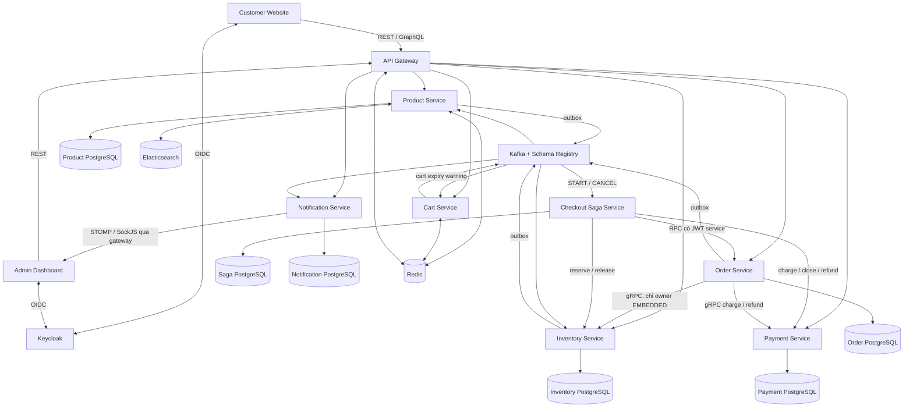
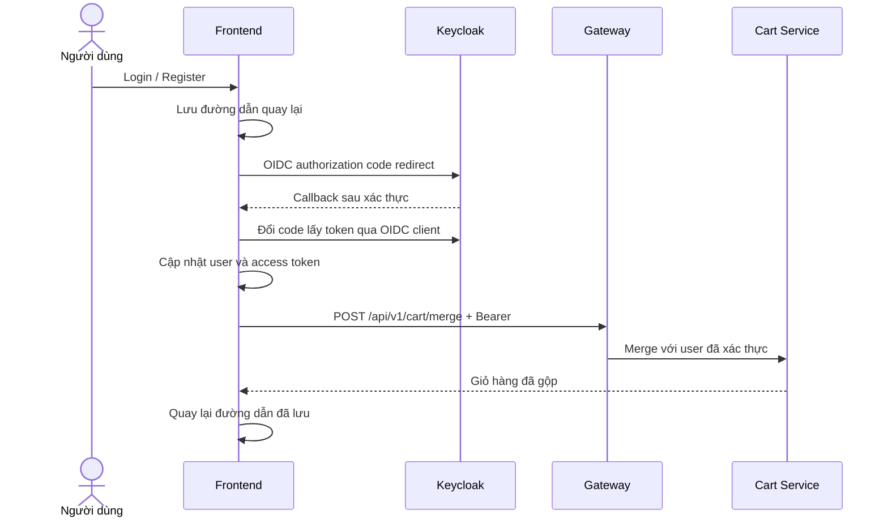
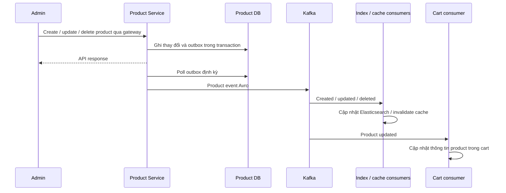
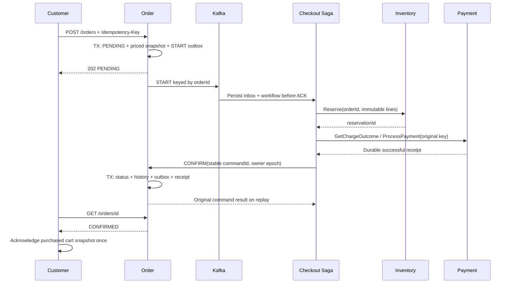
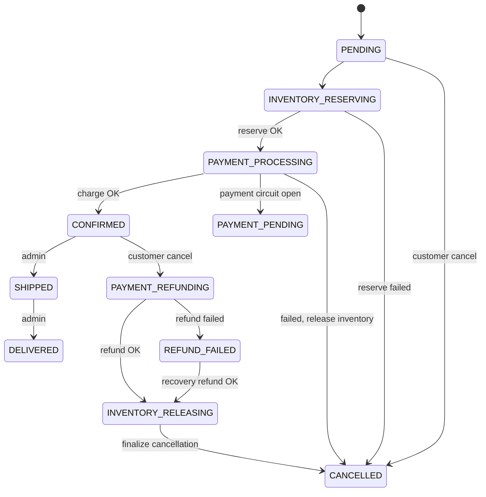
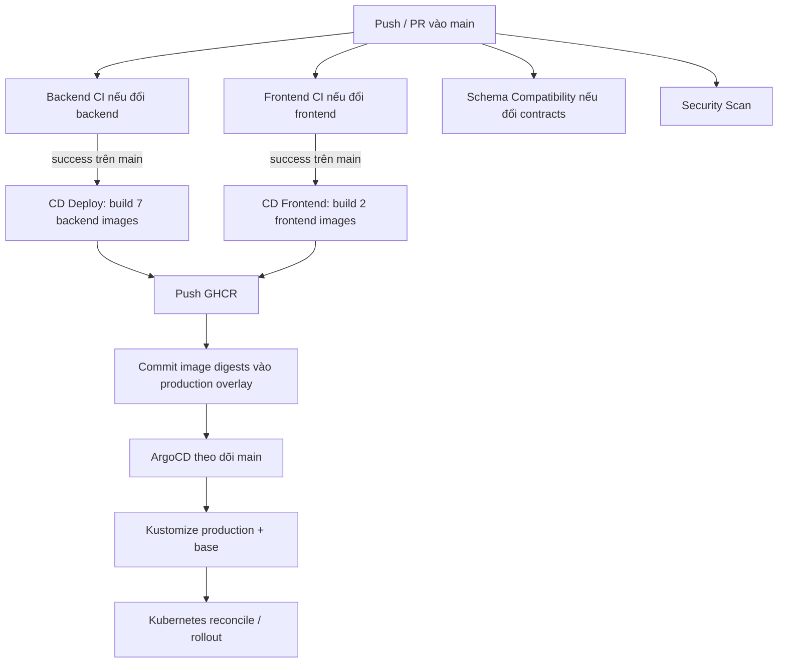

# Robo-Mart — Luồng development và hoạt động hệ thống

> Cập nhật các luồng chính theo mã nguồn ngày 09/11/2026, gồm Saga Service riêng, các wave 6–9 và sửa checkout/retry/deep link. Kết quả chạy và phạm vi môi trường được ghi trong từng báo cáo kiểm chứng.
> Đây là mô tả hiện trạng checkout, không phải xác nhận hệ thống đang chạy thành công trên local hoặc production. Những bước đề xuất và phần chưa hoàn thiện được ghi riêng.

## Mục lục

1. [Tài liệu hiện có và cách đọc](#1-tài-liệu-hiện-có-và-cách-đọc)
2. [Tổng quan kiến trúc](#2-tổng-quan-kiến-trúc)
3. [Bản đồ source code và dữ liệu](#3-bản-đồ-source-code-và-dữ-liệu)
4. [Dựng môi trường development](#4-dựng-môi-trường-development)
5. [Quy trình phát triển một tính năng](#5-quy-trình-phát-triển-một-tính-năng)
6. [Luồng request, đăng nhập và phân quyền](#6-luồng-request-đăng-nhập-và-phân-quyền)
7. [Luồng sản phẩm và tìm kiếm](#7-luồng-sản-phẩm-và-tìm-kiếm)
8. [Luồng giỏ hàng](#8-luồng-giỏ-hàng)
9. [Luồng checkout, inventory và payment](#9-luồng-checkout-inventory-và-payment)
10. [Luồng hủy đơn và phục hồi Saga](#10-luồng-hủy-đơn-và-phục-hồi-saga)
11. [Luồng sự kiện, notification và dashboard](#11-luồng-sự-kiện-notification-và-dashboard)
12. [CI/CD và triển khai](#12-cicd-và-triển-khai)
13. [Vận hành, debug và kiểm chứng](#13-vận-hành-debug-và-kiểm-chứng)
14. [Giới hạn hiện tại cần nắm](#14-giới-hạn-hiện-tại-cần-nắm)
15. [Điểm vào mã nguồn](#15-điểm-vào-mã-nguồn)

## 1. Tài liệu hiện có và cách đọc

Repository đã có tài liệu khá rộng nhưng nằm ở nhiều nơi:

| Tài liệu | Nội dung và cách sử dụng |
| --- | --- |
| [`CLAUDE.md`](../CLAUDE.md) | Hướng dẫn nhanh build, stack, conventions; một số lệnh frontend tổng quát không khớp scripts thực tế. |
| [`ecommerce_system_spec.md`](../ecommerce_system_spec.md) | Phác thảo hệ thống ban đầu. |
| [`prd.md`](../_bmad-output/planning-artifacts/prd.md) | Yêu cầu và phạm vi sản phẩm. |
| [`architecture.md`](../_bmad-output/planning-artifacts/architecture.md) | Thiết kế kiến trúc; cần đối chiếu code trước khi coi là tính năng đã có. |
| [`epics.md`](../_bmad-output/planning-artifacts/epics.md) | Chia nhỏ yêu cầu thành epic/story. |
| [`implementation-artifacts/`](../_bmad-output/implementation-artifacts/) | Story, retrospective, investigation và deferred work; hữu ích để hiểu lịch sử quyết định. |
| [`cicd-guide.md`](cicd-guide.md), [`cicd-flow.md`](cicd-flow.md) | Tài liệu CI/CD trước đây; workflows YAML hiện tại là nguồn đối chiếu cho hành vi thực tế. |
| [`argocd-gitops-guide.md`](argocd-gitops-guide.md) | Giải thích GitOps/ArgoCD và hướng dẫn migration. |
| [`k8s-setup-guide.md`](k8s-setup-guide.md), [`k8s-setup-step-by-step.md`](k8s-setup-step-by-step.md) | Hướng dẫn dựng cluster và dependencies; đối chiếu manifests hiện tại khi áp dụng. |

Bản này nối các phần thành luồng onboarding → phát triển → kiểm thử → triển khai → xử lý nghiệp vụ → vận hành. Khi tài liệu và code khác nhau, các file nguồn được dẫn ở cuối từng phần là căn cứ của mô tả hiện trạng.

## 2. Tổng quan kiến trúc

Robo-Mart là ứng dụng thương mại điện tử theo microservices, có website khách hàng và dashboard quản trị. Backend dùng Java 25, Spring Boot 4.1.2, Spring Cloud 2025.1.4; frontend dùng Vue 3, TypeScript, Pinia, PrimeVue, Tailwind và Vite.



Ba kiểu giao tiếp cần phân biệt:

- **HTTP đồng bộ:** browser → gateway → service; notification còn gọi HTTP nội bộ để lấy thông tin đơn hàng, sản phẩm và health.
- **gRPC đồng bộ:** Saga Service gọi Inventory/Payment và gửi command đến Order cho owner `EXTERNAL`; embedded engine tiếp tục xử lý Order cũ hoặc Order được tạo khi admission EXTERNAL tắt. Mỗi RPC có deadline và idempotency riêng.
- **Kafka bất đồng bộ:** Order outbox chuyển START/CANCEL đến Saga qua `order.checkout.requests.v1`, key là order ID. Các topic nghiệp vụ còn lại tiếp tục đồng bộ catalog, giỏ hàng, notification và admin feed.

Mỗi service sở hữu dữ liệu của mình. Không có transaction ACID bao trùm các database; checkout dùng Saga và thao tác bù để xử lý lỗi giữa các service.

## 3. Bản đồ source code và dữ liệu

```text
backend/
  pom.xml                 Maven reactor, version và quality gates
  common-core/            DTO, exception và audit contract, không kéo JPA runtime
  common-web-starter/     Auto-configuration cho servlet, Jackson, audit và observability
  common-lib/             Facade tương thích cho selector CI cũ
  outbox-lib/             Claim có fencing, gửi bất đồng bộ và retention dùng chung
  security-lib/           JWT roles và tiện ích auth
  proto/                  Hợp đồng gRPC, sinh protobuf/stubs
  events/                 Hợp đồng Avro và mã sự kiện được sinh
  test-support/           Testcontainers và hỗ trợ test dùng chung
  api-gateway/            Routes, JWT/RBAC, CORS, identity headers, rate limit
  product-service/         Catalog, search, cache, ảnh, product outbox
  cart-service/            Redis cart, merge, expiry warning
  order-service/           Orders, workflow participant, embedded compatibility, history/audit
  checkout-saga-service/   Workflow kỹ thuật, inbox, lease, retry, compensation và manual review
  inventory-service/       Tồn kho, reservation, lock, stock movement
  payment-service/         Payment/refund, idempotency, mock gateway
  notification-service/    Notification logs, DLQ, WebSocket, health, đối soát
  e2e-tests/               Các bài test cần stack tích hợp
  k6/                      Kịch bản tải/concurrent orders/flash sale
frontend/
  customer-website/        Website khách hàng
  admin-dashboard/        Dashboard quản trị
  shared/                 Thành phần/tokens dùng chung
infra/
  docker/                 Compose và Dockerfiles theo service
  k8s/                    Base, overlays, ArgoCD và monitoring
  ci/scripts/             Kiểm tra OpenAPI drift
.github/workflows/        CI, CD, schema compatibility, security scan
_bmad-output/             Yêu cầu, thiết kế và hồ sơ implementation
```

### Service và port mặc định

| Thành phần | HTTP local | gRPC | Nơi lưu dữ liệu |
| --- | --- | --- | --- |
| API Gateway | 8080 | — | Redis phục vụ rate limiting |
| Product | 8081 | — | `product_db`, PostgreSQL 5432; Elasticsearch; Redis cache |
| Cart | 8082 | — | Redis, TTL mặc định 24 giờ |
| Order | 8083 | 9093 | `order_db`, PostgreSQL 5434 |
| Inventory | 8084 | 9094 | `inventory_db`, PostgreSQL 5435; conditional SQL và row lock |
| Payment | 8086 | 9095 | `payment_db`, PostgreSQL 5436 |
| Notification | 8087 | — | `notification_db`, PostgreSQL 5437 |
| Keycloak | 8180 | — | PostgreSQL 5433 |
| Customer / Admin | 5173 / 5174 | — | Browser state; dữ liệu nghiệp vụ qua API |

Các port khác: Redis 6379, Elasticsearch 9200, Kafka host 29092, Schema Registry 8085, Kafka UI 9090. Overlay Compose monitoring khai báo Grafana 3000, Prometheus 9091, Loki 3100, Tempo 3200 và OTLP 4317/4318, Pact Broker 9292.

**Phân biệt môi trường:** bảng trên là port host khi chạy service trực tiếp và dependencies bằng Compose. Profile `app` không publish toàn bộ port backend ra host. Trong Docker, Kafka dùng `kafka:9092`; `localhost:29092` dành cho chương trình chạy trên host.

Nguồn: [`backend/pom.xml`](../backend/pom.xml), [`docker-compose.yml`](../infra/docker/docker-compose.yml), [`docker-compose.full.yml`](../infra/docker/docker-compose.full.yml) và `application.yml` của từng service.

## 4. Dựng môi trường development

### 4.1 Chuẩn bị

- JDK 25; dùng Maven Wrapper đã có trong `backend/`, khớp parent POM và Backend CI.
- Docker có Compose v2 để chạy dependencies và Testcontainers.
- Node phù hợp `engines` của frontend (`^20.19.0 || >=22.12.0`); CI dùng Node 22. Dùng npm với lockfile đã commit.
- Chừa đủ tài nguyên cho PostgreSQL, Kafka, Elasticsearch và nhiều JVM. Dựng một phần stack khi chỉ sửa một service sẽ nhẹ hơn chạy toàn bộ.

Các lệnh dưới đây được chạy từ thư mục gốc repository, trừ nơi có ghi khác. Đây là runbook dựa trên cấu hình; chưa thực thi smoke test toàn stack trong lần cập nhật tài liệu này.

### 4.2 Khởi động dependencies

```bash
# Chỉ tạo .env từ mẫu nếu chưa có; kiểm tra lại port và credentials local.
test -f infra/docker/.env || cp infra/docker/.env.example infra/docker/.env

docker compose -f infra/docker/docker-compose.yml --profile core up -d
docker compose -f infra/docker/docker-compose.yml --profile core ps
```

Profile `core` chạy hạ tầng, không tự chạy các backend app. Keycloak import realm `robomart` từ `infra/docker/keycloak/robomart-realm.json` khi khởi tạo. Cấu hình mặc định service trỏ tới localhost; nếu đổi credentials/port trong Compose, phải đổi cấu hình ứng dụng tương ứng.

### 4.3 Build backend và chạy service trên host

```bash
cd backend
./mvnw clean install -DskipTests -DskipITs -DskipE2ETests
```

Sau khi dependencies đã healthy, chạy **mỗi lệnh trong một terminal riêng**, tại `backend/`:

```bash
./mvnw spring-boot:run -pl :product-service -Dspring-boot.run.profiles=dev
./mvnw spring-boot:run -pl :cart-service -Dspring-boot.run.profiles=dev
./mvnw spring-boot:run -pl :inventory-service -Dspring-boot.run.profiles=dev
./mvnw spring-boot:run -pl :payment-service -Dspring-boot.run.profiles=dev
./mvnw spring-boot:run -pl :order-service -Dspring-boot.run.profiles=dev
./mvnw spring-boot:run -pl :notification-service -Dspring-boot.run.profiles=dev
./mvnw spring-boot:run -pl :api-gateway -Dspring-boot.run.profiles=dev
```

`install` trước giúp các service resolve shared modules từ Maven local repository. Khi sửa shared module, build/install lại module đó và dependencies liên quan. Flyway áp dụng migrations lúc service dùng PostgreSQL khởi động; Hibernate dùng `ddl-auto: validate` trong cấu hình dev đã kiểm tra.

Seed data nằm ở `src/main/resources/db/seed/` của Product, Inventory, Order. Không còn tự kích hoạt profile `dev`; các lệnh trên chọn profile này rõ ràng. Profile `dev` chỉ chạy migrations; profiles `demo`/`test` bổ sung seed locations. Để chạy có dữ liệu mẫu, thêm `-Dspring-boot.run.profiles=dev,demo` vào lệnh chạy từng service Product, Inventory, Order; ví dụ `./mvnw spring-boot:run -pl :product-service -Dspring-boot.run.profiles=dev,demo`. Bảo đảm product ID khớp inventory ID và kiểm tra nội dung seed trước khi dùng DB có dữ liệu cần giữ.

### 4.4 Chạy hai frontend

```bash
cd frontend
npm ci
npm run dev --workspace customer-website -- --port 5173 --strictPort
```

Terminal thứ hai, cũng ở `frontend/`:

```bash
npm run dev --workspace admin-dashboard -- --port 5174 --strictPort
```

`frontend/package.json` hiện **không có** scripts `dev`, `build`, `lint`, `type-check` ở root. Cần chỉ định workspace hoặc vào thư mục app.

Các biến Vite thường dùng trong `.env.local` riêng của từng app:

| Biến | Customer mặc định | Admin mặc định |
| --- | --- | --- |
| `VITE_API_URL` | `http://localhost:8080` | `http://localhost:8080` |
| `VITE_KEYCLOAK_URL` | `http://localhost:8180` | `http://localhost:8180` |
| `VITE_KEYCLOAK_REALM` | `robomart` | `robomart` |
| `VITE_KEYCLOAK_CLIENT_ID` | `robo-mart-frontend` | `robo-mart-admin` |

Vite đưa các giá trị này vào bundle lúc build. Khi đổi hostname triển khai, cần build lại frontend và đồng bộ redirect URI/web origins của Keycloak, CORS gateway.

Có thể cài hook từ root bằng `bash frontend/setup-hooks.sh`. Hook hiện có giới hạn: nó tìm thay đổi so với upstream nhưng dùng `lint-staged` cho file đang staged; không thay thế việc tự chạy kiểm tra và CI.

### 4.5 Docker toàn stack và monitoring

Repository có profile `app` dùng `backend/Dockerfile.prebuilt`; phải build JAR trước. Lệnh dự kiến:

```bash
docker compose -f infra/docker/docker-compose.yml --profile core --profile app up -d --build
```

**Cần giải quyết các lệch cấu hình ở mục 14 trước khi coi lệnh này là đường chạy đáng tin cậy.** Đường development ưu tiên trong tài liệu này là dependencies bằng Docker, service và Vite chạy trên host.

Để bật thêm monitoring/Pact, Compose cần cả hai file và profile `full`:

```bash
docker compose -f infra/docker/docker-compose.yml \
  -f infra/docker/docker-compose.full.yml \
  --profile core --profile full up -d
```

Khi app chạy trên host, kiểm tra endpoint scrape của Prometheus/Alloy: các hostname Docker của app không tự trỏ tới JVM trên host. Có container monitoring không đồng nghĩa đã nhận được telemetry.

## 5. Quy trình phát triển một tính năng

Phần này là quy trình làm việc đề xuất, ghép từ cấu trúc repo và checks hiện có; không khẳng định đây là branch policy đã được enforce trên GitHub.

```mermaid
flowchart LR
    R[Yêu cầu / lỗi] --> S[Đọc PRD, story và code]
    S --> D[Xác định API, schema, dữ liệu, nhánh lỗi]
    D --> B[Backend + migration + contracts]
    B --> F[Frontend + auth + trạng thái UI]
    F --> T[Unit / integration / contract / smoke]
    T --> PR[Pull request và review]
    PR --> CI[CI theo phần thay đổi]
    CI --> M[Merge main]
    M --> CD[Build image và cập nhật GitOps]
    CD --> V[ArgoCD sync và kiểm tra rollout]
```



1. **Làm rõ hành vi:** tác nhân nào thực hiện, quyền gì, dữ liệu nào đổi, thành công và lỗi hiển thị ra sao. Đọc story/architecture để hiểu ý định rồi xác nhận code hiện tại.
2. **Xác định service sở hữu:** catalog ở Product, stock ở Inventory, Order/history/outbox ở Order, tiến trình Saga EXTERNAL ở Saga Service, charge/refund ở Payment. Tránh viết chéo DB giữa các service.
3. **Chốt contracts:** REST request/response và error code; `.proto` nếu thay gRPC; Avro nếu thay Kafka. Giữ tương thích khi producer và consumer deploy khác thời điểm. Để plugin sinh code, không chỉnh generated classes.
4. **Đổi dữ liệu:** thêm Flyway migration có version mới; không sửa migration đã áp dụng. Thiết kế migration cho giai đoạn service cũ và mới có thể cùng chạy.
5. **Implement backend:** validation → application/service logic → repository hoặc client; bổ sung authorization, idempotency, outbox, compensation/audit phù hợp thao tác.
6. **Implement frontend:** API client → Pinia/composable → view; đủ loading, empty, lỗi, token hết hạn, degraded mode. Đối chiếu trạng thái server thay vì suy diễn từ animation UI.
7. **Kiểm thử:** business rules bằng unit test; DB/Kafka/Redis/gRPC và concurrency bằng integration test; hợp đồng bằng schema/Pact khi áp dụng; smoke thao tác quan trọng trên stack tích hợp.
8. **Review và bàn giao:** PR giải thích hành vi trước/sau, migration/config cần đổi, cách test và giới hạn. Cập nhật tài liệu luồng nếu thay contracts, trạng thái đơn hay deployment.

### Các lệnh kiểm tra

Backend, tại `backend/`:

```bash
# Unit test một service; các dependency modules cần đã install.
./mvnw test -pl :order-service

# Test một class cụ thể.
./mvnw test -pl :order-service -Dtest=OrderSagaOrchestratorTest

# Build dependency subtree, rồi verify riêng service như CI.
./mvnw install -pl :order-service -am -DskipTests -DskipITs -DskipE2ETests
./mvnw verify -pl :order-service -DskipE2ETests

./mvnw checkstyle:check
```

`test` và `verify` có phạm vi khác nhau: các module cấu hình Failsafe chạy integration tests ở lifecycle `verify`; Testcontainers cần Docker. JaCoCo parent đặt gate line coverage 80% với các exclusions khai báo. E2E mặc định tắt; xem [`e2e-tests/pom.xml`](../backend/e2e-tests/pom.xml) và [`k6/README.md`](../backend/k6/README.md) trước khi chạy E2E/performance/chaos trên stack.

Frontend, tại `frontend/`:

```bash
npm run type-check --workspace customer-website
npm run type-check --workspace admin-dashboard
npm run test:unit --workspace customer-website -- --run
npm run test:unit --workspace admin-dashboard -- --run
npm run lint --workspace customer-website
npm run lint --workspace admin-dashboard
npm run build --workspace customer-website
npm run build --workspace admin-dashboard
```

Scripts lint hiện dùng `--fix`, có thể đổi file. Kiểm tra formatting từ từng app bằng `npx prettier --check src/`. Browser E2E dùng Chromium, Keycloak và backend thật trong stack riêng: xem [`infra/e2e/README.md`](../infra/e2e/README.md). Chạy `npm run test:e2e --workspace=customer-website` tại `frontend/` sau khi stack đã khỏe; runner tự build và mở preview ở `localhost:5173`.

## 6. Luồng request, đăng nhập và phân quyền

### 6.1 Request thông thường

1. View gọi Pinia store hoặc API module; Axios dùng `VITE_API_URL`.
2. Client đính Bearer token khi có session; giỏ anonymous còn có định danh riêng.
3. Gateway xử lý JWT, RBAC, CORS, identity/correlation headers và rate limiting theo filters/config.
4. `RouteConfig` chọn service theo path, giữ API prefix tương ứng.
5. Controller validate input → service thực hiện nghiệp vụ → repository/client thao tác dependencies.
6. Trả DTO/response envelope có trace information; frontend cập nhật state hoặc hiển thị lỗi.

JWT roles được lấy từ claim lồng `realm_access.roles` qua `KeycloakRealmRoleConverter`. Luồng header định danh phải đi qua gateway và các security filters hiện có; không coi header do browser tự gửi là bằng chứng xác thực.

### 6.2 Đăng nhập và đăng ký

Customer khôi phục auth trước khi cài router, vì việc cài router bắt đầu navigation đầu tiên. Guard của route được bảo vệ chuyển tới Keycloak khi chưa đăng nhập và lưu `to.fullPath`; sau callback giữ nguyên path, query và fragment, kể cả khi mở trực tiếp hoặc reload trang đơn hàng.



Customer và Admin dùng OIDC client khác nhau; OIDC user được lưu trong `sessionStorage` theo cấu hình hiện có. Customer có silent renewal và xử lý sự kiện auth. Merge cart lỗi được coi là không chặn đăng nhập.

### 6.3 Quyền ở gateway

| Nhóm endpoint | Quyền khai báo |
| --- | --- |
| `/api/v1/products/**`, `/graphql` | Public |
| `/api/v1/cart/**` | Public, trừ POST merge cần authenticated |
| `/api/v1/orders/**` | Authenticated; service kiểm tra đơn thuộc user |
| `/api/v1/admin/**` | Role `ADMIN` |
| `/actuator/**` | Bị chặn trên listener public; management port riêng phục vụ health/metrics nội bộ |
| `/ws/**` | Cho qua HTTP handshake; Notification xác thực JWT trong STOMP CONNECT |
| Path còn lại | Authenticated; vẫn cần có route để chuyển downstream |

JWT resource servers kiểm tra issuer và audience `robomart-api`; JWK có thể lấy qua URL nội bộ riêng. Gateway cho phép HTTP handshake `/ws/**`, còn Notification kiểm tra token và quyền trong STOMP. Khi kiểm chứng realtime phải xác nhận cả subscription và event nhận được.

Nguồn: [`RouteConfig.java`](../backend/api-gateway/src/main/java/com/robomart/gateway/config/RouteConfig.java), [`GatewaySecurityConfig.java`](../backend/api-gateway/src/main/java/com/robomart/gateway/config/GatewaySecurityConfig.java), [`security-lib/`](../backend/security-lib/), `src/auth/` của hai frontend.

## 7. Luồng sản phẩm và tìm kiếm

### Khách duyệt catalog

- Danh sách: `GET /api/v1/products`; chi tiết: `GET /api/v1/products/{productId}`.
- Tìm kiếm: `GET /api/v1/products/search`; GraphQL đi qua `/graphql` với controller/schema của Product.
- Redis cache giúp giảm truy cập hệ lưu trữ. `CacheConfig` đặt TTL product cache 5 phút và search cache 1 phút.
- Search ưu tiên Elasticsearch, có keyword, category, brand, khoảng giá, rating. Page size được chặn tối đa 100 trong search service.
- Khi Elasticsearch lỗi, fallback PostgreSQL LIKE chỉ áp dụng keyword/category; không bảo toàn toàn bộ filter và relevance ranking của Elasticsearch.

### Admin cập nhật catalog



API ghi thành công không đảm bảo Elasticsearch và mọi giỏ hàng đã cập nhật ngay. Nếu catalog đúng nhưng search cũ, kiểm tra outbox và consumer trước khi kết luận DB bị mất dữ liệu.

Tồn kho hiển thị là projection từ Inventory: Product creation tạo inventory bằng 0 nếu chưa có; mỗi thay đổi stock ghi snapshot có version vào outbox. Product chỉ nhận version mới hơn rồi phát event cập nhật thông thường để index/cache tiếp tục xử lý. Không dùng SQL copy số tồn giữa database; xem [luồng đồng bộ tồn kho](inventory-catalog-sync.md).

Ảnh sản phẩm có API upload/delete/reorder, lưu object qua AWS SDK v2 và trả URL công khai của S3/CDN. Compose dùng MinIO ở cổng9002; E2E dùng19002. Volume/PVC cũ được giữ chỉ đọc tại `/migration/images`; URL `/images/**` cũ chuyển hướng sau bước copy/kiểm checksum tường minh. Production cần provision bucket và `product-s3-secret` trước rollout; xem [hướng dẫn migration](product-object-storage.md).

Nguồn: [`product/service/`](../backend/product-service/src/main/java/com/robomart/product/service/), [`product/event/consumer/`](../backend/product-service/src/main/java/com/robomart/product/event/consumer/), [`Cart ProductEventConsumer`](../backend/cart-service/src/main/java/com/robomart/cart/event/consumer/ProductEventConsumer.java).

## 8. Luồng giỏ hàng

1. Anonymous client giữ ID ở localStorage (`robomart-user-id`); cart API hỗ trợ `X-Cart-Id`/`X-User-Id` theo đường request và filters.
2. Cart controller ưu tiên user ID, sau đó cart ID, nếu thiếu thì sinh UUID. Client cần giữ định danh qua các request để không tạo giỏ mới ngoài ý muốn.
3. Thêm/sửa/xóa qua `/api/v1/cart/items`; dữ liệu nằm trong Redis, TTL cấu hình mặc định 1.440 phút. Các thao tác lưu cart cập nhật TTL theo code.
4. Frontend có optimistic update ở đổi quantity/xóa item; lỗi API thì phục hồi state trước đó.
5. Khi login, merge cộng số lượng sản phẩm trùng (giới hạn 9.999), lưu cart của user, xóa cart anonymous. Tự merge vào chính nó là no-op.
6. Scheduler cảnh báo hết hạn chạy mỗi 30 phút, kiểm tra giỏ có user, có item và TTL còn tối đa 2 giờ rồi publish `cart.cart.expiry-warning`; Notification nhận để tạo cảnh báo theo điều kiện của consumer.

Cart là ý định mua, chưa giữ tồn kho. Tồn kho được reserve ở checkout. Sau khi order được chấp nhận (`CONFIRMED`, `SHIPPED`, `DELIVERED`), frontend gọi `POST /api/v1/cart/checkout` với order ID và bản chụp các dòng đã mua. Redis Lua trừ đúng quantity một lần cho mỗi order; `lineId` giữ các dòng đã xóa/thêm lại hoặc sửa quantity từ tab khác. Hàng thêm cùng dòng sau lúc gửi order được giữ lại ở phần quantity dư. API này chỉ sửa giỏ của JWT subject, không tạo hoặc charge order. Cart rỗng vẫn giữ receipt theo TTL để retry không xóa hàng mới thêm.

Lỗi dọn giỏ không đổi kết quả đặt hàng thành thất bại. Bản ghi checkout được giữ để trang xác nhận tự thử lại sau reload hoặc qua nút Refresh Cart. Order bị hủy/đang giải phóng tồn kho không dọn giỏ. Client mới cần Cart Service mới; giữ chiến lược Recreate hiện có khi thay Cart writers.

Nguồn: [`CartRestController.java`](../backend/cart-service/src/main/java/com/robomart/cart/controller/CartRestController.java), [`CartMergeService.java`](../backend/cart-service/src/main/java/com/robomart/cart/service/CartMergeService.java), [`useCartStore.ts`](../frontend/customer-website/src/stores/useCartStore.ts).

## 9. Luồng checkout, inventory và payment

### 9.1 Checkout EXTERNAL và chế độ tương thích

`ROBOMART_ORDER_EXTERNAL_SAGA_ENABLED` quyết định owner khi **tạo** Order; owner/epoch được lưu cùng snapshot giá và START outbox trong một transaction. Mặc định phát triển/production giữ `false` để triển khai participant, DB, identity và worker trước; fixture E2E bật `true`. Đổi cờ chỉ tác động Order mới. Order EXTERNAL đang xử lý vẫn do service riêng tiếp tục điều phối.



Saga lưu intent trước RPC, nhận việc bằng lease 30 giây và CAS theo claim token; không giữ transaction/kết nối DB trong lúc gọi participant. Workflow đã xác nhận chuyển sang `CHECKOUT_CONFIRMED`, vẫn được giữ để nhận cancellation sau đó. Lease, attempt/age budget và manual review không phải bằng chứng cho phép trả kho.

Customer hiển thị PENDING đúng trạng thái, poll trong cửa sổ tối đa khoảng hai phút, backoff từ 2 đến 30 giây khi đọc lỗi và dừng khi unmount/kết thúc. Key/payload/giỏ được giữ qua reload. Chỉ `CONFIRMED`, `SHIPPED`, `DELIVERED` cho phép consume giỏ; PENDING hoặc PAYMENT_PENDING không đủ.

Order `EMBEDDED` vẫn chạy engine cũ đồng bộ và thường trả 201 khi xác nhận thành công; pending/recovery cũ được giữ cho tương thích. Các scan và write của embedded engine đều kiểm tra owner. Không xóa engine khi vẫn còn Order cũ cần hủy/phục hồi.

**Payload hiện tại:** frontend gửi `productId`, `productName`, `quantity`, `unitPrice`, `shippingAddress`. Order bỏ qua tên/giá do client gửi và lấy giá hiện tại từ Product trước transaction tạo đơn. API hỗ trợ `Idempotency-Key` theo user để replay cùng order. `paymentData` của form không được đưa vào request tạo đơn; Payment vẫn dùng mock provider với currency `USD`.

### 9.2 Bảo vệ tồn kho

Inventory reserve dùng conditional SQL theo thứ tự product ID, trong một transaction cho toàn bộ order; không phụ thuộc Redis lock. Thao tác đồng thời có retry contention giới hạn; thiếu một dòng stock sẽ rollback tất cả reservation lines, movements và outbox của lần reserve đó. Low-stock alert chỉ phát khi vượt qua ngưỡng từ trên xuống.

Reservation và các line đã lưu là nguồn cho replay, commit và release theo order. Release claim trạng thái và khóa row Inventory; chỉ hoàn lại đúng các line đã reserve. Event xác nhận đơn commit phần reserved, còn cancellation/refund có thể trả lại stock đã commit. Expiry job hỏi trạng thái order; kết quả chưa rõ giữ stock và chuyển sang kiểm tra/manual review, không tự giải phóng chỉ vì hết TTL.

### 9.3 Payment và idempotency

Payment Service lưu intent, payment, refund receipts và mock provider ledger trong PostgreSQL. Saga charge dùng order ID làm idempotency key; lease có fencing và provider call nằm ngoài transaction của application. Mock hỗ trợ replay sau restart và các tình huống transient failure, decline, delay; đây vẫn chưa phải tích hợp PSP thật.

POST tạo order có idempotency khi caller gửi lại cùng `Idempotency-Key` cho cùng user. Customer lưu key và payload gốc vào sessionStorage theo user trước request đầu tiên; retry HTTP/token refresh và reload gửi lại đúng key/payload đó. Bản ghi không lưu số thẻ/CVV. Lỗi chưa rõ kết quả giữ nguyên lần checkout; lỗi nghiệp vụ xác định hoặc validation trước tạo order cho phép bắt đầu lần mới. Khi order được chấp nhận, chỉ bỏ bản ghi sau khi dọn giỏ được xác nhận hoặc biết order đã hủy. sessionStorage có phạm vi từng tab và bị mất khi đóng/xóa phiên; đây không phải cơ chế chống hai lần mua độc lập trên nhiều thiết bị.

### 9.4 Các nhánh lỗi EXTERNAL chính

| Tình huống | Hành vi |
| --- | --- |
| Saga/Kafka chưa sẵn sàng | Order/outbox vẫn commit, trả 202 PENDING; cùng key replay cùng Order. |
| Không đủ stock | Claim cancellation, đóng charge, tạo release tombstone và finalize CANCELLED; không charge. |
| Payment decline cuối cùng | Chuyển sang compensation, xác nhận kết quả charge cuối cùng trước release. |
| Charge/close/refund timeout hoặc chưa rõ | Giữ stock và trạng thái chưa kết thúc; retry cùng key, không suy luận timeout là chưa charge/đã refund. |
| Mất reply sau participant commit | Đối chiếu receipt bền vững và replay intent/command cũ; không tạo khóa thanh toán mới. |
| Release lỗi/mất ACK | Replay cùng order; Inventory trả kho đúng một lần, Order chưa finalize trước ACK. |
| Hết ngân sách recovery | Manual review trong Saga DB; giữ tiền/kho chưa rõ, resume có ADMIN và audit reason. |


Nguồn: [`useCheckoutStore.ts`](../frontend/customer-website/src/stores/useCheckoutStore.ts), [`OrderService.java`](../backend/order-service/src/main/java/com/robomart/order/service/OrderService.java), [`OrderSagaOrchestrator.java`](../backend/order-service/src/main/java/com/robomart/order/saga/OrderSagaOrchestrator.java), [`inventory/service/`](../backend/inventory-service/src/main/java/com/robomart/inventory/service/), [`payment/service/`](../backend/payment-service/src/main/java/com/robomart/payment/service/).

## 10. Luồng hủy đơn và phục hồi Saga

### Hủy và phục hồi EXTERNAL

Order nhận cancel bằng transaction khóa row, chuyển `CANCELLATION_PENDING`, ghi CANCEL outbox rồi trả 202. CONFIRM và shipping cạnh tranh qua business state/version; shipping thắng thì hủy bị từ chối trước refund. Saga chạy `BEGIN_CANCEL → CLOSE_CHARGE → REFUND nếu đã charge → RELEASE → FINALIZE_CANCEL`. Payment đóng tại provider lock để worker charge đến muộn cũng bị chặn. Chỉ no-charge/decline cuối cùng hoặc refund đã xác nhận và release đã ACK mới chuyển CANCELLED.

RPC mới tại Order/Payment yêu cầu JWT đã ký với issuer/audience hợp lệ, `azp=checkout-saga-service` và role `SAGA_SERVICE`. Saga có DB riêng; không đọc/ghi trực tiếp DB của participant. ADMIN đọc `/api/v1/admin/sagas` và resume `/{sagaId}/resume` với reason. Các bước dở dang hoặc tiền chưa rõ phải xử lý bằng receipt; không sửa tay thành CANCELLED để bỏ qua compensation.

Có thể chuyển giao Order EMBEDDED đã CONFIRMED qua `POST /api/v1/admin/orders/{id}/workflow/adopt` với reason. Endpoint khóa row, tăng epoch, giữ refs/snapshot và ghi audit/START; Saga đối chiếu receipt rồi giữ checkout đã hoàn tất, không reserve/charge lại. Order legacy đang xử lý phải phục hồi xong trước khi chuyển giao. Rollback admission chỉ đổi owner của Order tạo sau đó, vẫn giữ external worker tương thích cho Order đã nhận.

### Trạng thái đơn EMBEDDED được giữ tương thích



Đây là các nhánh nghiệp vụ chính; recovery có thể chuyển những Saga kẹt sang cancellation. `CONFIRMED` được `isTerminal()` coi là terminal cho một số kiểm tra Saga, nhưng vẫn có các bước fulfillment `SHIPPED`/`DELIVERED`.

### Hủy đơn

- Customer gọi `POST /api/v1/orders/{id}/cancel`; service kiểm tra ownership và chỉ chấp nhận `PENDING` hoặc `CONFIRMED`.
- Với `PENDING`, release reservation nếu có, ghi cancellation reason, history và `order_cancelled` outbox.
- Với `CONFIRMED`, chuyển `PAYMENT_REFUNDING`, thực hiện refund trước. Refund thành công mới chuyển `INVENTORY_RELEASING`, release stock và finalize `CANCELLED`.
- Refund lỗi giữ `REFUND_FAILED` để recovery retry; không đánh dấu đã hủy hoàn tất khi còn nợ refund.
- Admin status API hiện cho phép `CONFIRMED → SHIPPED → DELIVERED`; không phải API chuyển tùy ý mọi trạng thái.

### Recovery

Saga lưu audit theo bước với key `{orderId}:{stepName}`; nếu đã ghi `SUCCESS` thì forward step có thể skip khi thực thi lại. Recovery quét tối đa 20 đơn mỗi lượt, bao gồm đơn EMBEDDED bị bỏ lại ở `PENDING` sau khi transaction tạo đơn đã commit. SQL loại các phase đang chờ retry hoặc cần manual review trước khi tải items. Scheduled job chạy mặc định mỗi 60 giây, sau initial delay 30 giây, ngưỡng kẹt 5 phút; ShedLock hạn chế job chạy đồng thời giữa replica.

`PAYMENT_PENDING` có worker riêng `PendingPaymentRecoveryJob`, mặc định scan mỗi 5 giây và backoff 30 giây sau provider failure. Worker dùng lại order/payment key và reservation cũ; giới hạn attempt/age được lưu bền vững. Hết budget chuyển manual review, giữ stock và có ADMIN API để review/resume. Customer cancel vẫn chỉ nhận `PENDING` hoặc `CONFIRMED`; không xem pending là đơn có thể tự bỏ qua charge rồi giải phóng stock.

Nguồn: [`OrderStatus.java`](../backend/order-service/src/main/java/com/robomart/order/enums/OrderStatus.java), [`DeadSagaDetectionJob.java`](../backend/order-service/src/main/java/com/robomart/order/saga/DeadSagaDetectionJob.java), [`OrderSagaOrchestrator.java`](../backend/order-service/src/main/java/com/robomart/order/saga/OrderSagaOrchestrator.java).

## 11. Luồng sự kiện, notification và dashboard

### 11.1 Outbox và tính nhất quán

Product, Inventory, Order có outbox polling mặc định mỗi giây. Poller chuyển payload sang event và publish Kafka, sau đó cập nhật trạng thái xử lý. Đây là mô hình có khả năng phát lại/nhận trùng; không coi là exactly-once end-to-end. Các consumer có cơ chế chống trùng ở một số đường, cần kiểm tra theo từng handler.

Các đường chuyển trạng thái và phục hồi chính ghi status/history/outbox trong transaction của service sở hữu. Shared `outbox-lib` claim aggregate head có fencing, giữ thứ tự theo aggregate, gửi ngoài transaction DB và chỉ acknowledge sau Kafka ACK. Unknown event được giữ lại và có metric; không giả vờ đã publish thành công.

| Kafka topic được đối chiếu | Producer / nguồn | Consumer và tác dụng |
| --- | --- | --- |
| `product.product.created` | Product outbox | Product index; Inventory khởi tạo stock bằng 0 nếu chưa tồn tại |
| `product.product.updated` | Product outbox | Index, cache invalidation, Cart product update |
| `product.product.deleted` | Product outbox | Index delete, cache invalidation |
| `order.order.status-changed` | Order outbox | Notification tạo thông báo và push admin feed |
| `inventory.stock.low-alert` | Inventory outbox | Notification cảnh báo tồn kho và push admin |
| `inventory.stock.updated` | Inventory outbox | Product cập nhật projection theo Inventory version, rồi phát Product updated |
| `cart.cart.expiry-warning` | Cart scheduler | Notification cảnh báo giỏ sắp hết hạn |
| `notification.dlq` | Kafka error handling | DLQ consumer lưu failed events để quản trị/retry |

Order còn publish cancellation event riêng; không phải mọi event được publish đều đã có consumer cho mọi tính năng sản phẩm.

### 11.2 Notification và DLQ

Notification consumer nhận order status, lấy chi tiết qua HTTP client rồi ghi notification log. `CONFIRMED` tạo thông báo xác nhận đơn và payment success. Nhánh `CANCELLED` có previous status `PAYMENT_PROCESSING` tạo payment failure notification.

`MockEmailService` là implementation trong profile `!production`, chỉ ghi log. Chưa thấy email provider thật trong source đã kiểm tra. `SENT` trong môi trường mock có nghĩa gọi mock thành công, không chứng minh có email được chuyển phát.

Kafka consumer retry/DLQ nằm trong `KafkaDlqConfig`; DLQ consumer lưu vào notification DB. Admin có API xem, retry một event và retry-all. Khi retry, phải sửa nguyên nhân trước và kiểm tra idempotency/processed-event state; không coi retry luôn tái thực hiện side effect đã lỗi.

### 11.3 Dashboard, report và đối soát

- Dashboard gọi API metrics của Order/Inventory và các API quản trị product, inventory, order, reports, DLQ, system health.
- Admin dùng SockJS/STOMP ở `/ws`, có Bearer trong CONNECT headers, reconnect delay 5 giây. Notification push `/topic/orders`, `/topic/inventory-alerts`, `/topic/system-health`, `/topic/admin/reconciliation-alerts`.
- Health scheduler mặc định mỗi 10 giây lấy health và push; cần phân biệt service HTTP healthy với từng dependency healthy.
- Report hiện query trực tiếp order/order-item repositories. `rebuildReadModels()` chỉ ghi log và trả timestamp, chưa dựng lại projection/read model độc lập.
- Reconciliation Service đối chiếu Order với Inventory/Payment qua HTTP summaries và push discrepancy. Scheduler mặc định 02:00 (inventory), 02:30 (payment), theo timezone runtime vì cron không khai báo zone cố định.
- Audit có log ở từng service và aggregator trong Notification. Route gateway cho aggregator/reconciliation còn thiếu; xem mục 14.

Nguồn: [`notification/event/`](../backend/notification-service/src/main/java/com/robomart/notification/event/), [`notification/service/`](../backend/notification-service/src/main/java/com/robomart/notification/service/), [`ReportService.java`](../backend/order-service/src/main/java/com/robomart/order/service/ReportService.java), [`websocketClient.ts`](../frontend/admin-dashboard/src/api/websocketClient.ts).

## 12. CI/CD và triển khai

### Luồng hiện tại được khai báo



**Backend CI:** build/install reactor không chạy test → Checkstyle → unit/coverage cho libs và gateway → matrix verify từng service/events trên runner riêng. Integration tests dùng Testcontainers; Pact provider tests chạy theo cấu hình module/broker. JaCoCo gate được áp dụng theo Maven config. OpenAPI drift chỉ chạy khi có `docs/api/*.json`; không có baseline thì skip.

**Frontend CI:** npm ci → type-check hai app → lint → Prettier check → Vitest → production build → accessibility audit website. Accessibility audit hiện informational, lỗi audit không tự làm pipeline fail.

**Schema Compatibility:** buf lint; PR có buf breaking so với main; events module chạy Avro compatibility integration test với Kafka/Schema Registry do Testcontainers dựng.

**Security Scan:** có scan dependency/secret/IaC và cấu hình scan khác trong workflow; riêng Trivy đang `--exit-code 0`, kết quả là báo cáo, không phải hard gate chặn mọi finding.

**CD:** Backend CI và Frontend CI kích hoạt hai workflow CD riêng trên main; cả hai còn hỗ trợ manual dispatch. Images đẩy lên GHCR, job publish digest đã kiểm chứng vào `infra/k8s/overlays/production/kustomization.yaml` cùng release audit record, commit `[skip ci]`. ArgoCD Application theo dõi overlay này, cấu hình auto-sync, prune và self-heal. Monitoring có Application riêng.

**Điều kiện triển khai:** cluster, ArgoCD, databases/Kafka/Redis/Elasticsearch/Keycloak, secrets, registry access, DNS/TLS và network phải được provision đúng. App manifests không tự chứng minh các dependencies đã được dựng. Hướng dẫn chi tiết nằm trong bộ tài liệu K8s đã dẫn ở mục 1.

### Release revision và quality gates

CD resolve một SHA đã qua push CI trên `main`, kiểm tra Security Scan và Schema Compatibility đã đăng ký cho cùng SHA. Helper policy được lấy từ `github.workflow_sha`; source build được checkout tường minh theo SHA đã resolve. OCI revision, full-SHA tag, image record và GitOps digest phải cùng nguồn.

GitOps pin digest và lưu audit record cho từng component. Publish dùng main mới nhất và retry non-fast-forward có giới hạn; component bị superseded không ghi đè release mới hơn. Rollback code cũ thực hiện bằng reviewed GitOps digest revert. Xem [release provenance và demo operations](release-provenance-and-demo-operations.md) cùng `infra/ci/scripts/release-policy.cjs`.

ArgoCD Application trong repo chưa tự chứng minh cluster đã sync. Với markserver, báo cáo ngày 29/10 ghi nhận đã khôi phục auto-sync; phải kiểm tra Application revision, health và prerequisite của chính môi trường trước mỗi rollout.

### Rollback đề xuất

Chọn tag/digest đã kiểm chứng, revert commit thay image tương ứng trong GitOps overlay, review rồi để ArgoCD sync. Với self-heal, đổi image thủ công bằng kubectl có thể bị ghi đè về Git. Image rollback không hoàn tác migration hoặc side effect payment; migration phải tương thích với app được rollback.

Nguồn: [`.github/workflows/`](../.github/workflows/), [`production overlay`](../infra/k8s/overlays/production/kustomization.yaml), [`ArgoCD Application`](../infra/k8s/argocd/robomart-app.yaml).

## 13. Vận hành, debug và kiểm chứng

### Theo dấu một request

Lấy order ID, user ID, thời điểm và correlation/trace ID từ response/log. Theo đường browser Network → gateway → service → gRPC/downstream → outbox/Kafka → consumer → WebSocket/notification. Shared tracing có HTTP/gRPC/Kafka propagation và structured logging; xem cấu hình sampling/export thực tế trước khi kỳ vọng tìm thấy trace trong Tempo.

| Triệu chứng | Điểm kiểm tra đầu tiên |
| --- | --- |
| Browser lỗi CORS/auth callback | Origin/port, redirect URI Keycloak, `VITE_*`, gateway CORS; cả request OPTIONS |
| API 401/403 | Token expiry, issuer/JWK URI, realm role ADMIN, header/filter propagation |
| Product DB đúng nhưng search cũ | Outbox status, Kafka topic, consumer lag/error, Elasticsearch index, cache TTL |
| Cart mất hoặc đổi giỏ | TTL, anonymous ID, header, auth cart key và kết quả merge |
| Order không xác nhận | Status/history, `saga_audit_log`, inventory reservation, payment/idempotency records |
| Order `PAYMENT_PENDING` kéo dài | Recovery due time/attempt/age, circuit state, `saga_recovery_state` và manual-review API |
| Order `REFUND_FAILED` | Refund logs, payment trạng thái thực, recovery job/ShedLock; kiểm tra trước khi thao tác tiền |
| Admin không nhận realtime | HTTP `/ws` handshake, STOMP CONNECT/auth, subscriptions, consumer, route/gateway security |
| Notification log SENT nhưng không có mail | Kiểm tra mock implementation/profile và địa chỉ recipient |
| Pod không ready / crash | Events/logs, DB credentials, hostname nội bộ, migration, probes, memory/CPU |
| ArgoCD OutOfSync hoặc image pull lỗi | Git revision/tag tồn tại, registry secret, overlay render, sync error |

### Smoke test đề xuất sau khi dựng môi trường

1. Mở catalog và detail; thử keyword/category/filter; đối chiếu dữ liệu mẫu.
2. Thêm giỏ anonymous, reload, sửa quantity; đăng nhập và xác minh merge.
3. Checkout sản phẩm có inventory; xác minh order `CONFIRMED`, reservation/payment cùng order ID, history và Kafka event.
4. Reload và kiểm tra cả UI cart lẫn Redis cart để phát hiện khác biệt reset state/server.
5. Hủy order `CONFIRMED`; xác minh refund, release và `CANCELLED`; thử refund failure trong môi trường test.
6. Thử hết stock/payment decline/payment unavailable; xác minh lỗi, compensation và `PAYMENT_PENDING` theo nhánh thực tế.
7. Admin cập nhật sản phẩm, restock, chuyển `CONFIRMED → SHIPPED → DELIVERED`; xác minh API và dashboard.
8. Kiểm tra WebSocket, DLQ retry và health; đối chiếu log/trace và side effects, không chỉ kiểm tra UI.

Khi dừng dependencies, dùng `docker compose ... down` giữ volumes nếu còn cần dữ liệu. `down -v` xóa dữ liệu volumes, chỉ dùng khi chủ động muốn reset môi trường.

## 14. Giới hạn hiện tại cần nắm

Các nhận định cũ về giá do client quyết định, thiếu API idempotency, Redis inventory lock, không có pending-payment recovery, thiếu gateway routes và CD không pin source đã được thay thế bởi implementation các wave 6–9 và release policy mới. Xem [finding status](backend-remediation-final-status.md), source hiện tại và các báo cáo chạy trong `_bmad-output/test-artifacts/`.

| Điểm | Hiện trạng và tác động |
| --- | --- |
| Root frontend scripts | Chạy scripts theo workspace; root không có `dev`/`build`/`test:unit`. |
| Payment thật | `MockPaymentGateway` có ledger bền vững nhưng chưa phải PSP thật; dữ liệu card của form không dùng để charge provider. |
| Checkout retry từ UI | Key/payload lưu theo user trong sessionStorage và giữ qua retry/reload. Đóng/xóa phiên làm mất bản ghi; giá vẫn do backend quyết định. |
| Cart checkout | Dọn bản chụp bằng Redis Lua nguyên tử, có receipt chống trừ lặp và line identity giữ chỉnh sửa sau checkout; lỗi dọn giỏ có thể thử lại tại trang xác nhận. |
| Email | `MockEmailService` chỉ log; trạng thái `SENT` chưa chứng minh email tới inbox. Production cần provider thật và recipient phù hợp. |
| Reporting | Query trực tiếp Order DB; rebuild hiện chưa dựng read model độc lập. |
| Stock projection | Catalog/search/cache cập nhật bất đồng bộ. Inventory vẫn quyết định có reserve được không; sản phẩm mới có thể cần chờ consumer khởi tạo inventory trước khi restock. |
| Frontend container port | Nginx listen 8080 nhưng Compose app còn map `5173:80`/`5174:80`; cần đồng bộ khi dùng frontend containers. Vite trên host không dùng mapping này. |
| Gateway Payment URL trong Compose | Gateway app env chưa override URI Payment; kiểm tra trước khi dùng đường admin Payment trong container. Các HTTP clients/JWK đã có override riêng, không xem tất cả là lỗi localhost cũ. |
| Reconciliation scalability | Inventory/Order còn summary không phân trang; Payment đã có paging. Không dùng triage cũ để suy ra cả ba service đều còn cùng implementation. |
| Môi trường demo | Markserver có các dependencies được provision riêng. Version Kafka/Schema Registry, bucket/secret, DNS/tunnel và state ArgoCD phải kiểm tra trực tiếp; không suy từ Compose local. |
| Runtime so với tài liệu | Story `done` và checklist implementation không thay thế test/runtime evidence. Phân biệt local fixture, demo markserver và provider thật. |

## 15. Điểm vào mã nguồn

| Muốn hiểu hoặc thay đổi | Bắt đầu từ |
| --- | --- |
| Public/admin routes, CORS, rate limit | [`gateway/config/`](../backend/api-gateway/src/main/java/com/robomart/gateway/config/), [`gateway/filter/`](../backend/api-gateway/src/main/java/com/robomart/gateway/filter/) |
| JWT roles | [`KeycloakRealmRoleConverter.java`](../backend/security-lib/src/main/java/com/robomart/security/converter/KeycloakRealmRoleConverter.java) |
| Search fallback và filters | [`ProductSearchService.java`](../backend/product-service/src/main/java/com/robomart/product/service/ProductSearchService.java) |
| Product write/outbox/cache/index | [`product/service/`](../backend/product-service/src/main/java/com/robomart/product/service/), [`product/event/`](../backend/product-service/src/main/java/com/robomart/product/event/) |
| Cart identity/merge/TTL | [`cart/controller/`](../backend/cart-service/src/main/java/com/robomart/cart/controller/), [`cart/service/`](../backend/cart-service/src/main/java/com/robomart/cart/service/) |
| Create/get/cancel order API | [`OrderRestController.java`](../backend/order-service/src/main/java/com/robomart/order/web/OrderRestController.java), [`OrderService.java`](../backend/order-service/src/main/java/com/robomart/order/service/OrderService.java) |
| Saga success/failure/recovery | [`order/saga/`](../backend/order-service/src/main/java/com/robomart/order/saga/) |
| Reserve/release và locking | [`inventory/service/`](../backend/inventory-service/src/main/java/com/robomart/inventory/service/), [`inventory/grpc/`](../backend/inventory-service/src/main/java/com/robomart/inventory/grpc/) |
| Payment/refund/idempotency | [`payment/service/`](../backend/payment-service/src/main/java/com/robomart/payment/service/) |
| Event contracts / gRPC contracts | [`events/`](../backend/events/), [`proto/`](../backend/proto/) |
| Notification/DLQ/health/reconciliation | [`notification-service/`](../backend/notification-service/src/main/java/com/robomart/notification/) |
| Customer screens và state | [`customer router`](../frontend/customer-website/src/router/index.ts), [`customer stores`](../frontend/customer-website/src/stores/) |
| Admin screens và realtime | [`admin router`](../frontend/admin-dashboard/src/router/index.ts), [`admin api`](../frontend/admin-dashboard/src/api/) |
| Build/deploy | [`.github/workflows/`](../.github/workflows/), [`infra/k8s/`](../infra/k8s/) |

Khi cập nhật tài liệu này, kiểm tra lại endpoint/route, trạng thái Saga, topic/consumer, scripts build và workflow deploy liên quan. Ghi rõ ngày đối chiếu và tách tính năng hiện có khỏi thiết kế hoặc đề xuất.


## Backend hardening — 2026-11-10

- Order HTTP lấy chủ đơn từ JWT đã xác thực; header `X-User-Id` không được phép thay đổi danh tính đó. Test JWT dùng subject riêng cho từng fixture, không mô phỏng đăng nhập bằng header tùy ý.
- Checkout giới hạn 100 dòng và lấy giá nhiều sản phẩm qua `GET /api/v1/products/batch?ids=...`. Fingerprint được lưu cho cả EMBEDDED và EXTERNAL; đơn cũ được đối chiếu với items và địa chỉ đã lưu khi replay.
- Triển khai Order/Inventory trước Notification khi đổi contract phân trang. Các endpoint reconciliation-summary của Order và Inventory nhận `page` (từ 0), cố định 100 dòng/trang. Notification đọc đến trang ngắn cuối cùng, có giới hạn 1.000 trang và thời gian; lỗi hoặc vượt giới hạn trả trạng thái ERROR. Doanh thu là tổng giá trị đơn CONFIRMED/SHIPPED/DELIVERED, không phải doanh thu ròng sau mọi khoản hoàn tiền riêng lẻ.
- Notification lưu kết quả đối soát trong DB. Mỗi replica đọc log `admin_broadcasts` để phát tới các WebSocket session cục bộ; log giữ một ngày và cleanup theo batch. Client mới vẫn dùng REST để lấy snapshot hiện tại. Trace ID được giữ trong envelope phát lại.
- Migration Notification V8 tạo trạng thái operations dùng chung; V9 tách `delivery_key` theo event khỏi liên kết cart trong notification log. Cần dừng consumer Notification cũ trước rollout V9 (deployment hiện dùng Recreate), vì một cart có thể có nhiều chu kỳ cảnh báo sau migration.
- p95 được ước lượng từ các histogram bucket Prometheus gộp theo service, không lấy tag quantile từ Actuator metrics. Endpoint Prometheus nội bộ cần được expose và histogram cần có samples.
- Cart giữ fence của event giá khi ADD về muộn, và dọn tối đa 100 thành viên reverse index đã hết hạn mỗi lần refresh. Checkout tiếp tục định giá lại và kiểm tra stock tại service sở hữu dữ liệu.
