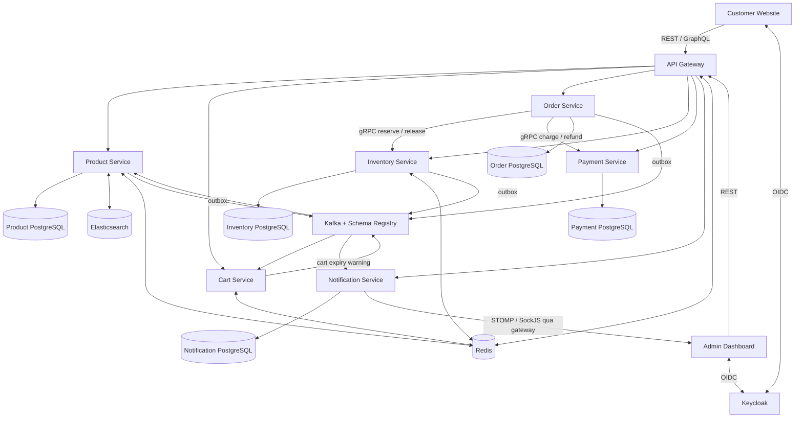
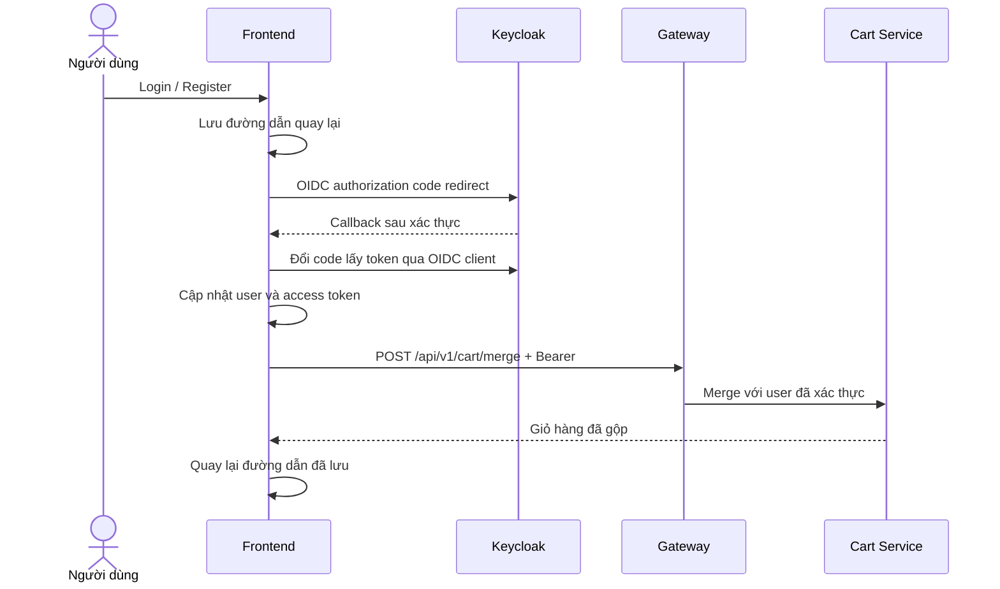
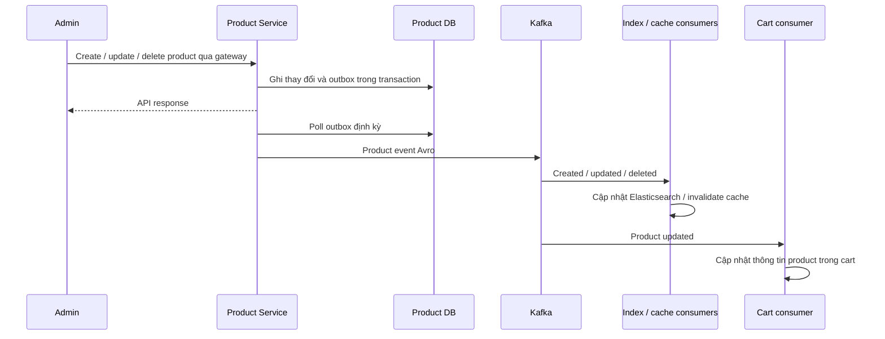
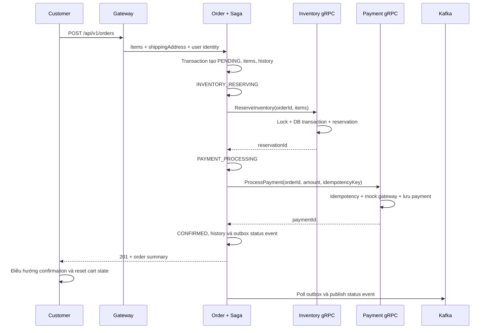
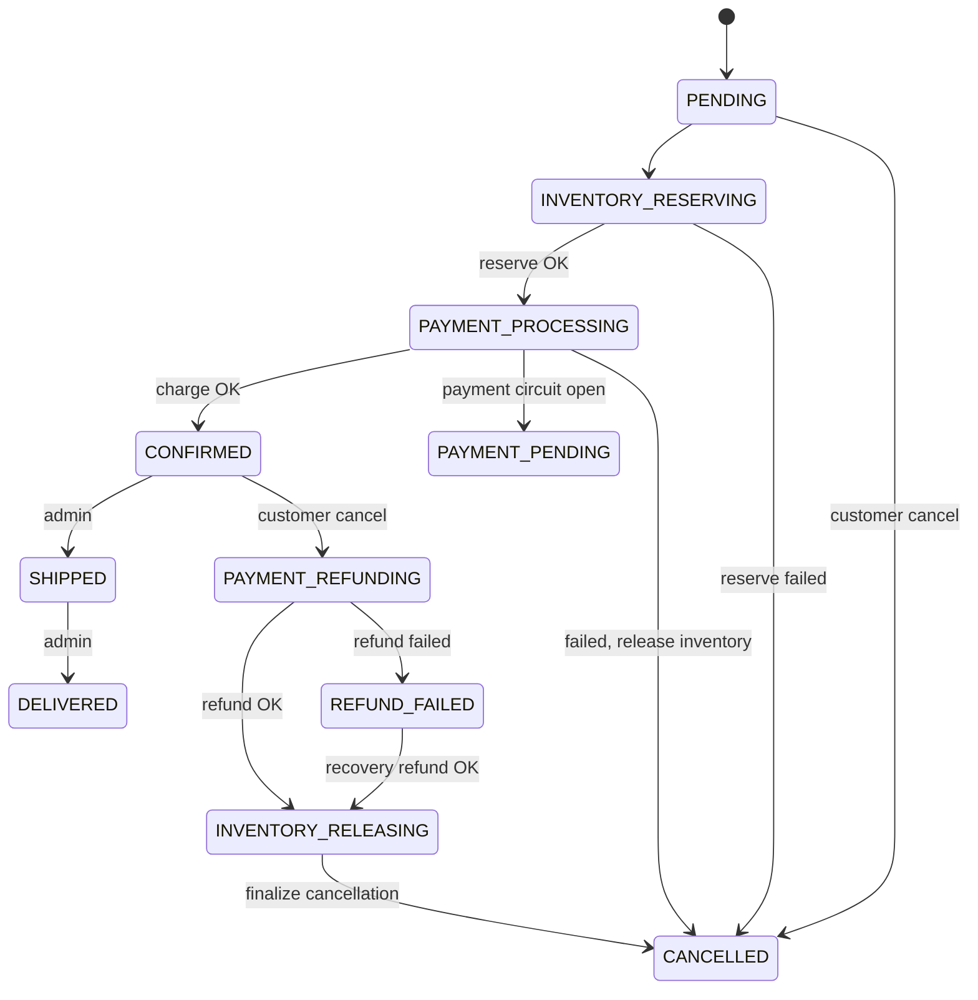
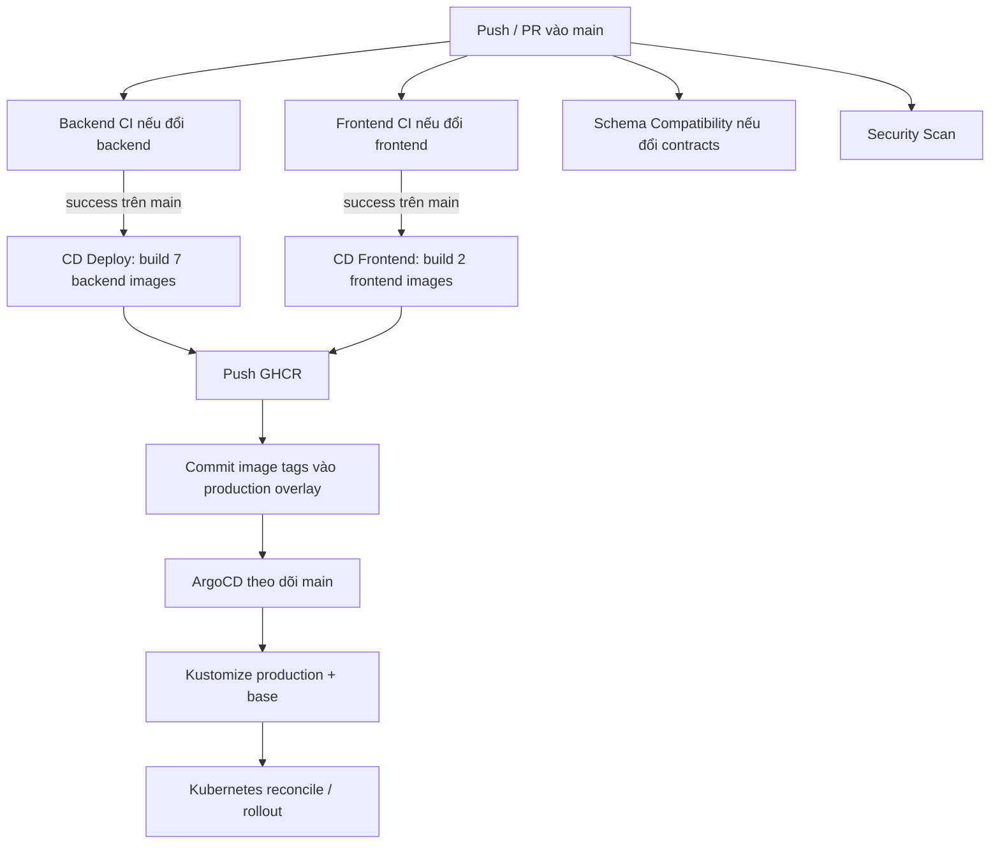

# Robo-Mart — Luồng development và hoạt động hệ thống

> Đối chiếu mã nguồn và cấu hình trong repository ngày 24/10/2026.
> Đây là mô tả hiện trạng checkout, không phải xác nhận hệ thống đang chạy thành công trên local hoặc production. Những bước đề xuất và phần chưa hoàn thiện được ghi riêng.

## Mục lục

1. [Tài liệu hiện có và cách đọc](#1-tài-liệu-hiện-có-và-cách-đọc)
2. [Tổng quan kiến trúc](#2-tổng-quan-kiến-trúc)
3. [Bản đồ source code và dữ liệu](#3-bản-đồ-source-code-và-dữ-liệu)
4. [Dựng môi trường development](#4-dựng-môi-trường-development)
5. [Quy trình phát triển một tính năng](#5-quy-trình-phát-triển-một-tính-năng)
6. [Luồng request, đăng nhập và phân quyền](#6-luồng-request-đăng-nhập-và-phân-quyền)
7. [Luồng sản phẩm và tìm kiếm](#7-luồng-sản-phẩm-và-tìm-kiếm)
8. [Luồng giỏ hàng](#8-luồng-giỏ-hàng)
9. [Luồng checkout, inventory và payment](#9-luồng-checkout-inventory-và-payment)
10. [Luồng hủy đơn và phục hồi Saga](#10-luồng-hủy-đơn-và-phục-hồi-saga)
11. [Luồng sự kiện, notification và dashboard](#11-luồng-sự-kiện-notification-và-dashboard)
12. [CI/CD và triển khai](#12-cicd-và-triển-khai)
13. [Vận hành, debug và kiểm chứng](#13-vận-hành-debug-và-kiểm-chứng)
14. [Giới hạn hiện tại cần nắm](#14-giới-hạn-hiện-tại-cần-nắm)
15. [Điểm vào mã nguồn](#15-điểm-vào-mã-nguồn)

## 1. Tài liệu hiện có và cách đọc

Repository đã có tài liệu khá rộng nhưng nằm ở nhiều nơi:

| Tài liệu | Nội dung và cách sử dụng |
| --- | --- |
| [`CLAUDE.md`](../CLAUDE.md) | Hướng dẫn nhanh build, stack, conventions; một số lệnh frontend tổng quát không khớp scripts thực tế. |
| [`ecommerce_system_spec.md`](../ecommerce_system_spec.md) | Phác thảo hệ thống ban đầu. |
| [`prd.md`](../_bmad-output/planning-artifacts/prd.md) | Yêu cầu và phạm vi sản phẩm. |
| [`architecture.md`](../_bmad-output/planning-artifacts/architecture.md) | Thiết kế kiến trúc; cần đối chiếu code trước khi coi là tính năng đã có. |
| [`epics.md`](../_bmad-output/planning-artifacts/epics.md) | Chia nhỏ yêu cầu thành epic/story. |
| [`implementation-artifacts/`](../_bmad-output/implementation-artifacts/) | Story, retrospective, investigation và deferred work; hữu ích để hiểu lịch sử quyết định. |
| [`cicd-guide.md`](cicd-guide.md), [`cicd-flow.md`](cicd-flow.md) | Tài liệu CI/CD trước đây; workflows YAML hiện tại là nguồn đối chiếu cho hành vi thực tế. |
| [`argocd-gitops-guide.md`](argocd-gitops-guide.md) | Giải thích GitOps/ArgoCD và hướng dẫn migration. |
| [`k8s-setup-guide.md`](k8s-setup-guide.md), [`k8s-setup-step-by-step.md`](k8s-setup-step-by-step.md) | Hướng dẫn dựng cluster và dependencies; đối chiếu manifests hiện tại khi áp dụng. |

Bản này nối các phần thành luồng onboarding → phát triển → kiểm thử → triển khai → xử lý nghiệp vụ → vận hành. Khi tài liệu và code khác nhau, các file nguồn được dẫn ở cuối từng phần là căn cứ của mô tả hiện trạng.

## 2. Tổng quan kiến trúc

Robo-Mart là ứng dụng thương mại điện tử theo microservices, có website khách hàng và dashboard quản trị. Backend dùng Java 21, Spring Boot 4.0.4, Spring Cloud 2025.1.1; frontend dùng Vue 3, TypeScript, Pinia, PrimeVue, Tailwind và Vite.



Ba kiểu giao tiếp cần phân biệt:

- **HTTP đồng bộ:** browser → gateway → service; notification còn gọi HTTP nội bộ để lấy thông tin đơn hàng, sản phẩm và health.
- **gRPC đồng bộ:** Order điều phối Inventory và Payment. Kafka không phải phương tiện điều phối hai bước checkout này.
- **Kafka bất đồng bộ:** đồng bộ chỉ mục tìm kiếm, vô hiệu cache, cập nhật thông tin giỏ hàng, notification và admin feed. Phần này có độ trễ so với transaction gốc.

Mỗi service sở hữu dữ liệu của mình. Không có transaction ACID bao trùm các database; checkout dùng Saga và thao tác bù để xử lý lỗi giữa các service.

## 3. Bản đồ source code và dữ liệu

```text
backend/
  pom.xml                 Maven reactor, version và quality gates
  common-lib/             DTO, exception, audit, correlation/tracing
  security-lib/           JWT roles và tiện ích auth
  proto/                  Hợp đồng gRPC, sinh protobuf/stubs
  events/                 Hợp đồng Avro và mã sự kiện được sinh
  test-support/           Testcontainers và hỗ trợ test dùng chung
  api-gateway/            Routes, JWT/RBAC, CORS, identity headers, rate limit
  product-service/         Catalog, search, cache, ảnh, product outbox
  cart-service/            Redis cart, merge, expiry warning
  order-service/           Orders, Saga, history/audit, report queries
  inventory-service/       Tồn kho, reservation, lock, stock movement
  payment-service/         Payment/refund, idempotency, mock gateway
  notification-service/    Notification logs, DLQ, WebSocket, health, đối soát
  e2e-tests/               Các bài test cần stack tích hợp
  k6/                      Kịch bản tải/concurrent orders/flash sale
frontend/
  customer-website/        Website khách hàng
  admin-dashboard/        Dashboard quản trị
  shared/                 Thành phần/tokens dùng chung
infra/
  docker/                 Compose và Dockerfiles theo service
  k8s/                    Base, overlays, ArgoCD và monitoring
  ci/scripts/             Kiểm tra OpenAPI drift
.github/workflows/        CI, CD, schema compatibility, security scan
_bmad-output/             Yêu cầu, thiết kế và hồ sơ implementation
```

### Service và port mặc định

| Thành phần | HTTP local | gRPC | Nơi lưu dữ liệu |
| --- | --- | --- | --- |
| API Gateway | 8080 | — | Redis phục vụ rate limiting |
| Product | 8081 | — | `product_db`, PostgreSQL 5432; Elasticsearch; Redis cache |
| Cart | 8082 | — | Redis, TTL mặc định 24 giờ |
| Order | 8083 | 9093 | `order_db`, PostgreSQL 5434 |
| Inventory | 8084 | 9094 | `inventory_db`, PostgreSQL 5435; Redis lock |
| Payment | 8086 | 9095 | `payment_db`, PostgreSQL 5436 |
| Notification | 8087 | — | `notification_db`, PostgreSQL 5437 |
| Keycloak | 8180 | — | PostgreSQL 5433 |
| Customer / Admin | 5173 / 5174 | — | Browser state; dữ liệu nghiệp vụ qua API |

Các port khác: Redis 6379, Elasticsearch 9200, Kafka host 29092, Schema Registry 8085, Kafka UI 9090. Overlay Compose monitoring khai báo Grafana 3000, Prometheus 9091, Loki 3100, Tempo 3200 và OTLP 4317/4318, Pact Broker 9292.

**Phân biệt môi trường:** bảng trên là port host khi chạy service trực tiếp và dependencies bằng Compose. Profile `app` không publish toàn bộ port backend ra host. Trong Docker, Kafka dùng `kafka:9092`; `localhost:29092` dành cho chương trình chạy trên host.

Nguồn: [`backend/pom.xml`](../backend/pom.xml), [`docker-compose.yml`](../infra/docker/docker-compose.yml), [`docker-compose.full.yml`](../infra/docker/docker-compose.full.yml) và `application.yml` của từng service.

## 4. Dựng môi trường development

### 4.1 Chuẩn bị

- JDK 21; dùng Maven Wrapper đã có trong `backend/`.
- Docker có Compose v2 để chạy dependencies và Testcontainers.
- Node phù hợp `engines` của frontend (`^20.19.0 || >=22.12.0`); CI dùng Node 22. Dùng npm với lockfile đã commit.
- Chừa đủ tài nguyên cho PostgreSQL, Kafka, Elasticsearch và nhiều JVM. Dựng một phần stack khi chỉ sửa một service sẽ nhẹ hơn chạy toàn bộ.

Các lệnh dưới đây được chạy từ thư mục gốc repository, trừ nơi có ghi khác. Đây là runbook dựa trên cấu hình; chưa thực thi smoke test toàn stack trong lần cập nhật tài liệu này.

### 4.2 Khởi động dependencies

```bash
# Chỉ tạo .env từ mẫu nếu chưa có; kiểm tra lại port và credentials local.
test -f infra/docker/.env || cp infra/docker/.env.example infra/docker/.env

docker compose -f infra/docker/docker-compose.yml --profile core up -d
docker compose -f infra/docker/docker-compose.yml --profile core ps
```

Profile `core` chạy hạ tầng, không tự chạy các backend app. Keycloak import realm `robomart` từ `infra/docker/keycloak/robomart-realm.json` khi khởi tạo. Cấu hình mặc định service trỏ tới localhost; nếu đổi credentials/port trong Compose, phải đổi cấu hình ứng dụng tương ứng.

### 4.3 Build backend và chạy service trên host

```bash
cd backend
./mvnw clean install -DskipTests -DskipITs -DskipE2ETests
```

Sau khi dependencies đã healthy, chạy **mỗi lệnh trong một terminal riêng**, tại `backend/`:

```bash
./mvnw spring-boot:run -pl :product-service -Dspring-boot.run.profiles=dev
./mvnw spring-boot:run -pl :cart-service -Dspring-boot.run.profiles=dev
./mvnw spring-boot:run -pl :inventory-service -Dspring-boot.run.profiles=dev
./mvnw spring-boot:run -pl :payment-service -Dspring-boot.run.profiles=dev
./mvnw spring-boot:run -pl :order-service -Dspring-boot.run.profiles=dev
./mvnw spring-boot:run -pl :notification-service -Dspring-boot.run.profiles=dev
./mvnw spring-boot:run -pl :api-gateway -Dspring-boot.run.profiles=dev
```

`install` trước giúp các service resolve shared modules từ Maven local repository. Khi sửa shared module, build/install lại module đó và dependencies liên quan. Flyway áp dụng migrations lúc service dùng PostgreSQL khởi động; Hibernate dùng `ddl-auto: validate` trong cấu hình dev đã kiểm tra.

Seed data nằm ở `src/main/resources/db/seed/` của Product, Inventory, Order. Không còn tự kích hoạt profile `dev`; các lệnh trên chọn profile này rõ ràng. Profile `dev` chỉ chạy migrations; profiles `demo`/`test` bổ sung seed locations. Để chạy có dữ liệu mẫu, thêm `-Dspring-boot.run.profiles=dev,demo` vào lệnh chạy từng service Product, Inventory, Order; ví dụ `./mvnw spring-boot:run -pl :product-service -Dspring-boot.run.profiles=dev,demo`. Bảo đảm product ID khớp inventory ID và kiểm tra nội dung seed trước khi dùng DB có dữ liệu cần giữ.

### 4.4 Chạy hai frontend

```bash
cd frontend
npm ci
npm run dev --workspace customer-website -- --port 5173 --strictPort
```

Terminal thứ hai, cũng ở `frontend/`:

```bash
npm run dev --workspace admin-dashboard -- --port 5174 --strictPort
```

`frontend/package.json` hiện **không có** scripts `dev`, `build`, `lint`, `type-check` ở root. Cần chỉ định workspace hoặc vào thư mục app.

Các biến Vite thường dùng trong `.env.local` riêng của từng app:

| Biến | Customer mặc định | Admin mặc định |
| --- | --- | --- |
| `VITE_API_URL` | `http://localhost:8080` | `http://localhost:8080` |
| `VITE_KEYCLOAK_URL` | `http://localhost:8180` | `http://localhost:8180` |
| `VITE_KEYCLOAK_REALM` | `robomart` | `robomart` |
| `VITE_KEYCLOAK_CLIENT_ID` | `robo-mart-frontend` | `robo-mart-admin` |

Vite đưa các giá trị này vào bundle lúc build. Khi đổi hostname triển khai, cần build lại frontend và đồng bộ redirect URI/web origins của Keycloak, CORS gateway.

Có thể cài hook từ root bằng `bash frontend/setup-hooks.sh`. Hook hiện có giới hạn: nó tìm thay đổi so với upstream nhưng dùng `lint-staged` cho file đang staged; không thay thế việc tự chạy kiểm tra và CI.

### 4.5 Docker toàn stack và monitoring

Repository có profile `app` dùng `backend/Dockerfile.prebuilt`; phải build JAR trước. Lệnh dự kiến:

```bash
docker compose -f infra/docker/docker-compose.yml --profile core --profile app up -d --build
```

**Cần giải quyết các lệch cấu hình ở mục 14 trước khi coi lệnh này là đường chạy đáng tin cậy.** Đường development ưu tiên trong tài liệu này là dependencies bằng Docker, service và Vite chạy trên host.

Để bật thêm monitoring/Pact, Compose cần cả hai file và profile `full`:

```bash
docker compose -f infra/docker/docker-compose.yml \
  -f infra/docker/docker-compose.full.yml \
  --profile core --profile full up -d
```

Khi app chạy trên host, kiểm tra endpoint scrape của Prometheus/Alloy: các hostname Docker của app không tự trỏ tới JVM trên host. Có container monitoring không đồng nghĩa đã nhận được telemetry.

## 5. Quy trình phát triển một tính năng

Phần này là quy trình làm việc đề xuất, ghép từ cấu trúc repo và checks hiện có; không khẳng định đây là branch policy đã được enforce trên GitHub.

```mermaid
flowchart LR
    R[Yêu cầu / lỗi] --> S[Đọc PRD, story và code]
    S --> D[Xác định API, schema, dữ liệu, nhánh lỗi]
    D --> B[Backend + migration + contracts]
    B --> F[Frontend + auth + trạng thái UI]
    F --> T[Unit / integration / contract / smoke]
    T --> PR[Pull request và review]
    PR --> CI[CI theo phần thay đổi]
    CI --> M[Merge main]
    M --> CD[Build image và cập nhật GitOps]
    CD --> V[ArgoCD sync và kiểm tra rollout]
```



1. **Làm rõ hành vi:** tác nhân nào thực hiện, quyền gì, dữ liệu nào đổi, thành công và lỗi hiển thị ra sao. Đọc story/architecture để hiểu ý định rồi xác nhận code hiện tại.
2. **Xác định service sở hữu:** catalog ở Product, stock ở Inventory, order/Saga ở Order, charge/refund ở Payment. Tránh viết chéo DB giữa các service.
3. **Chốt contracts:** REST request/response và error code; `.proto` nếu thay gRPC; Avro nếu thay Kafka. Giữ tương thích khi producer và consumer deploy khác thời điểm. Để plugin sinh code, không chỉnh generated classes.
4. **Đổi dữ liệu:** thêm Flyway migration có version mới; không sửa migration đã áp dụng. Thiết kế migration cho giai đoạn service cũ và mới có thể cùng chạy.
5. **Implement backend:** validation → application/service logic → repository hoặc client; bổ sung authorization, idempotency, outbox, compensation/audit phù hợp thao tác.
6. **Implement frontend:** API client → Pinia/composable → view; đủ loading, empty, lỗi, token hết hạn, degraded mode. Đối chiếu trạng thái server thay vì suy diễn từ animation UI.
7. **Kiểm thử:** business rules bằng unit test; DB/Kafka/Redis/gRPC và concurrency bằng integration test; hợp đồng bằng schema/Pact khi áp dụng; smoke thao tác quan trọng trên stack tích hợp.
8. **Review và bàn giao:** PR giải thích hành vi trước/sau, migration/config cần đổi, cách test và giới hạn. Cập nhật tài liệu luồng nếu thay contracts, trạng thái đơn hay deployment.

### Các lệnh kiểm tra

Backend, tại `backend/`:

```bash
# Unit test một service; các dependency modules cần đã install.
./mvnw test -pl :order-service

# Test một class cụ thể.
./mvnw test -pl :order-service -Dtest=OrderSagaOrchestratorTest

# Build dependency subtree, rồi verify riêng service như CI.
./mvnw install -pl :order-service -am -DskipTests -DskipITs -DskipE2ETests
./mvnw verify -pl :order-service -DskipE2ETests

./mvnw checkstyle:check
```

`test` và `verify` có phạm vi khác nhau: các module cấu hình Failsafe chạy integration tests ở lifecycle `verify`; Testcontainers cần Docker. JaCoCo parent đặt gate line coverage 80% với các exclusions khai báo. E2E mặc định tắt; xem [`e2e-tests/pom.xml`](../backend/e2e-tests/pom.xml) và [`k6/README.md`](../backend/k6/README.md) trước khi chạy E2E/performance/chaos trên stack.

Frontend, tại `frontend/`:

```bash
npm run type-check --workspace customer-website
npm run type-check --workspace admin-dashboard
npm run test:unit --workspace customer-website -- --run
npm run test:unit --workspace admin-dashboard -- --run
npm run lint --workspace customer-website
npm run lint --workspace admin-dashboard
npm run build --workspace customer-website
npm run build --workspace admin-dashboard
```

Scripts lint hiện dùng `--fix`, có thể đổi file. Kiểm tra formatting từ từng app bằng `npx prettier --check src/`. Các checks trên là runbook cho thay đổi code; lần bổ sung tài liệu này chỉ kiểm tra tài liệu, không chạy lại toàn bộ test suite.

## 6. Luồng request, đăng nhập và phân quyền

### 6.1 Request thông thường

1. View gọi Pinia store hoặc API module; Axios dùng `VITE_API_URL`.
2. Client đính Bearer token khi có session; giỏ anonymous còn có định danh riêng.
3. Gateway xử lý JWT, RBAC, CORS, identity/correlation headers và rate limiting theo filters/config.
4. `RouteConfig` chọn service theo path, giữ API prefix tương ứng.
5. Controller validate input → service thực hiện nghiệp vụ → repository/client thao tác dependencies.
6. Trả DTO/response envelope có trace information; frontend cập nhật state hoặc hiển thị lỗi.

JWT roles được lấy từ claim lồng `realm_access.roles` qua `KeycloakRealmRoleConverter`. Luồng header định danh phải đi qua gateway và các security filters hiện có; không coi header do browser tự gửi là bằng chứng xác thực.

### 6.2 Đăng nhập và đăng ký



Customer và Admin dùng OIDC client khác nhau; OIDC user được lưu trong `sessionStorage` theo cấu hình hiện có. Customer có silent renewal và xử lý sự kiện auth. Merge cart lỗi được coi là không chặn đăng nhập.

### 6.3 Quyền ở gateway

| Nhóm endpoint | Quyền khai báo |
| --- | --- |
| `/api/v1/products/**`, `/graphql` | Public |
| `/api/v1/cart/**` | Public, trừ POST merge cần authenticated |
| `/api/v1/orders/**` | Authenticated; service kiểm tra đơn thuộc user |
| `/api/v1/admin/**` | Role `ADMIN` |
| `/actuator/**` | Permit all tại gateway; mức thông tin trả về còn do actuator config |
| Path còn lại | Authenticated; vẫn cần có route để chuyển downstream |

`/ws` còn liên quan xác thực STOMP CONNECT và HTTP handshake. Không chỉ kiểm tra token trong CONNECT rồi kết luận browser handshake sẽ thành công qua gateway; xem giới hạn tại mục 14.

Nguồn: [`RouteConfig.java`](../backend/api-gateway/src/main/java/com/robomart/gateway/config/RouteConfig.java), [`GatewaySecurityConfig.java`](../backend/api-gateway/src/main/java/com/robomart/gateway/config/GatewaySecurityConfig.java), [`security-lib/`](../backend/security-lib/), `src/auth/` của hai frontend.

## 7. Luồng sản phẩm và tìm kiếm

### Khách duyệt catalog

- Danh sách: `GET /api/v1/products`; chi tiết: `GET /api/v1/products/{productId}`.
- Tìm kiếm: `GET /api/v1/products/search`; GraphQL đi qua `/graphql` với controller/schema của Product.
- Redis cache giúp giảm truy cập hệ lưu trữ. `CacheConfig` đặt TTL product cache 5 phút và search cache 1 phút.
- Search ưu tiên Elasticsearch, có keyword, category, brand, khoảng giá, rating. Page size được chặn tối đa 100 trong search service.
- Khi Elasticsearch lỗi, fallback PostgreSQL LIKE chỉ áp dụng keyword/category; không bảo toàn toàn bộ filter và relevance ranking của Elasticsearch.

### Admin cập nhật catalog



API ghi thành công không đảm bảo Elasticsearch và mọi giỏ hàng đã cập nhật ngay. Nếu catalog đúng nhưng search cũ, kiểm tra outbox và consumer trước khi kết luận DB bị mất dữ liệu.

Ảnh sản phẩm có API upload/delete/reorder. Cấu hình mặc định lưu file ở `/tmp/robomart-images`; cần kiểm tra serving URL, gateway routing và storage volume khi triển khai nhiều replica hoặc restart container. Xem mục 14.

Nguồn: [`product/service/`](../backend/product-service/src/main/java/com/robomart/product/service/), [`product/event/consumer/`](../backend/product-service/src/main/java/com/robomart/product/event/consumer/), [`Cart ProductEventConsumer`](../backend/cart-service/src/main/java/com/robomart/cart/event/consumer/ProductEventConsumer.java).

## 8. Luồng giỏ hàng

1. Anonymous client giữ ID ở localStorage (`robomart-user-id`); cart API hỗ trợ `X-Cart-Id`/`X-User-Id` theo đường request và filters.
2. Cart controller ưu tiên user ID, sau đó cart ID, nếu thiếu thì sinh UUID. Client cần giữ định danh qua các request để không tạo giỏ mới ngoài ý muốn.
3. Thêm/sửa/xóa qua `/api/v1/cart/items`; dữ liệu nằm trong Redis, TTL cấu hình mặc định 1.440 phút. Các thao tác lưu cart cập nhật TTL theo code.
4. Frontend có optimistic update ở đổi quantity/xóa item; lỗi API thì phục hồi state trước đó.
5. Khi login, merge cộng số lượng sản phẩm trùng (giới hạn 9.999), lưu cart của user, xóa cart anonymous. Tự merge vào chính nó là no-op.
6. Scheduler cảnh báo hết hạn chạy mỗi 30 phút, kiểm tra giỏ có user, có item và TTL còn tối đa 2 giờ rồi publish `cart.cart.expiry-warning`; Notification nhận để tạo cảnh báo theo điều kiện của consumer.

Cart là ý định mua, chưa giữ tồn kho. Tồn kho được reserve ở checkout. Checkout hiện reset Pinia cart sau khi API đặt đơn trả thành công; chưa thấy bước tương ứng xóa cart Redis trong luồng này, nên không coi UI rỗng là cart server đã bị xóa.

Nguồn: [`CartRestController.java`](../backend/cart-service/src/main/java/com/robomart/cart/controller/CartRestController.java), [`CartMergeService.java`](../backend/cart-service/src/main/java/com/robomart/cart/service/CartMergeService.java), [`useCartStore.ts`](../frontend/customer-website/src/stores/useCartStore.ts).

## 9. Luồng checkout, inventory và payment

### 9.1 Happy path từ UI đến database

UI có bốn bước: xem lại giỏ → địa chỉ giao hàng → thông tin payment → xác nhận. Sau submit, các dòng “Creating / Reserving / Processing” đổi bằng timer 1,5 giây; đây là animation chờ, không phải stream tiến độ từng bước từ backend.



Saga chạy trong đường thực thi `createOrder`; mỗi forward step được chạy qua virtual-thread executor với timeout. API không chỉ enqueue rồi lập tức trả một job ID. Các transaction DB được tách theo bước, không giữ một transaction DB mở xuyên suốt mọi gRPC call.

**Payload hiện tại:** frontend gửi `productId`, `productName`, `quantity`, `unitPrice`, `shippingAddress`. Order tính tổng từ giá request. `paymentData` của form không được đưa vào request tạo đơn; step payment dùng tổng đơn và currency `USD`. Đây là luồng mô phỏng thanh toán hiện tại.

### 9.2 Bảo vệ tồn kho

Inventory dùng Redis distributed lock theo product, TTL lock mặc định 10 giây, kết hợp transaction và optimistic locking bằng `@Version` trên `InventoryItem`. Repository `findByProductId` hiện không khai báo pessimistic lock, dù comment trong service có nhắc tới nó. Reserve kiểm tra quantity, giảm available, tăng reserved, ghi stock movement/outbox và low-stock alert khi dưới ngưỡng. Sau transaction có kiểm tra lock ownership; mất lock sẽ đi vào xử lý bù.

Reservation được lưu phục vụ idempotency/release theo order. gRPC handler kiểm tra replay theo order, reserve lần lượt từng item, theo dõi item đã thành công và gọi rollback cho chúng nếu bước sau thất bại. Đây là thao tác bù giữa các lần reserve, không phải một transaction duy nhất cho mọi item; lỗi rollback được ghi log. Cần kiểm thử cả tình huống một item thành công nhưng item tiếp theo hết hàng.

### 9.3 Payment và idempotency

Payment Service lưu payment/idempotency data trong PostgreSQL; TTL idempotency key khai báo 24 giờ. Saga charge dùng order ID làm idempotency key. `MockPaymentGateway` hỗ trợ replay cùng key và mô phỏng transient failure, decline, delay; map charge của mock ở RAM không phải sổ giao dịch bền vững của nhà cung cấp thật.

Không suy ra POST tạo order có idempotency end-to-end: tạo hai order mới sẽ có hai order ID và hai payment keys khác nhau. UI chỉ chặn double-submit trong cùng store đang xử lý.

### 9.4 Các nhánh lỗi chính

| Tình huống | Hành vi hiện có |
| --- | --- |
| Không đủ stock | Cancel đơn với lý do `Insufficient stock`; không tiếp tục charge. |
| Inventory circuit open | Lỗi tạm thời; Saga đi nhánh cancellation/compensation theo step, API trả lỗi inventory. |
| Payment bị decline | Release inventory qua compensation, chuyển `CANCELLED`, API trả lỗi payment. |
| Payment circuit open | Giữ inventory, chuyển `PAYMENT_PENDING`, trả HTTP 202. |
| Forward step quá timeout | Ghi audit `TIMED_OUT`, đi nhánh lỗi/bù; không xem timeout là bằng chứng service đích chưa tạo side effect. |
| Lỗi release khi bù | Ghi `COMPENSATION_FAILED`; một số đường vẫn finalize cancellation. Cần đối soát, không hứa rollback tuyệt đối. |

Nguồn: [`useCheckoutStore.ts`](../frontend/customer-website/src/stores/useCheckoutStore.ts), [`OrderService.java`](../backend/order-service/src/main/java/com/robomart/order/service/OrderService.java), [`OrderSagaOrchestrator.java`](../backend/order-service/src/main/java/com/robomart/order/saga/OrderSagaOrchestrator.java), [`inventory/service/`](../backend/inventory-service/src/main/java/com/robomart/inventory/service/), [`payment/service/`](../backend/payment-service/src/main/java/com/robomart/payment/service/).

## 10. Luồng hủy đơn và phục hồi Saga

### Trạng thái đơn



Đây là các nhánh nghiệp vụ chính; recovery có thể chuyển những Saga kẹt sang cancellation. `CONFIRMED` được `isTerminal()` coi là terminal cho một số kiểm tra Saga, nhưng vẫn có các bước fulfillment `SHIPPED`/`DELIVERED`.

### Hủy đơn

- Customer gọi `POST /api/v1/orders/{id}/cancel`; service kiểm tra ownership và chỉ chấp nhận `PENDING` hoặc `CONFIRMED`.
- Với `PENDING`, release reservation nếu có, ghi cancellation reason, history và `order_cancelled` outbox.
- Với `CONFIRMED`, chuyển `PAYMENT_REFUNDING`, thực hiện refund trước. Refund thành công mới chuyển `INVENTORY_RELEASING`, release stock và finalize `CANCELLED`.
- Refund lỗi giữ `REFUND_FAILED` để recovery retry; không đánh dấu đã hủy hoàn tất khi còn nợ refund.
- Admin status API hiện cho phép `CONFIRMED → SHIPPED → DELIVERED`; không phải API chuyển tùy ý mọi trạng thái.

### Recovery

Saga lưu audit theo bước với key `{orderId}:{stepName}`; nếu đã ghi `SUCCESS` thì forward step có thể skip khi thực thi lại. Khi app ready, orchestrator tìm các Saga ở trạng thái trung gian để phục hồi. Scheduled job chạy mặc định mỗi 60 giây, sau initial delay 30 giây, ngưỡng kẹt 5 phút; ShedLock hạn chế job chạy đồng thời giữa replica.

`PAYMENT_PENDING` bị loại khỏi cả danh sách dead Saga và startup recovery hiện tại. Chưa thấy worker tự charge lại/resume trạng thái này; customer cancellation cũng không cho phép trạng thái đó. Vì vậy cần xem đây là phần recovery chưa khép kín, không mô tả “payment phục hồi thì đơn tự chạy tiếp”.

Nguồn: [`OrderStatus.java`](../backend/order-service/src/main/java/com/robomart/order/enums/OrderStatus.java), [`DeadSagaDetectionJob.java`](../backend/order-service/src/main/java/com/robomart/order/saga/DeadSagaDetectionJob.java), [`OrderSagaOrchestrator.java`](../backend/order-service/src/main/java/com/robomart/order/saga/OrderSagaOrchestrator.java).

## 11. Luồng sự kiện, notification và dashboard

### 11.1 Outbox và tính nhất quán

Product, Inventory, Order có outbox polling mặc định mỗi giây. Poller chuyển payload sang event và publish Kafka, sau đó cập nhật trạng thái xử lý. Đây là mô hình có khả năng phát lại/nhận trùng; không coi là exactly-once end-to-end. Các consumer có cơ chế chống trùng ở một số đường, cần kiểm tra theo từng handler.

Đặc biệt, Order Saga cập nhật status và tạo status-changed outbox trong các transaction riêng ở một số đường; không giả định mọi status update luôn atomic với event. Riêng `finalizeCancellation` ghi cancellation/history/outbox trong cùng transaction.

| Kafka topic được đối chiếu | Producer / nguồn | Consumer và tác dụng |
| --- | --- | --- |
| `product.product.created` | Product outbox | Product index consumer tạo document search |
| `product.product.updated` | Product outbox | Index, cache invalidation, Cart product update |
| `product.product.deleted` | Product outbox | Index delete, cache invalidation |
| `order.order.status-changed` | Order outbox | Notification tạo thông báo và push admin feed |
| `inventory.stock.low-alert` | Inventory outbox | Notification cảnh báo tồn kho và push admin |
| `cart.cart.expiry-warning` | Cart scheduler | Notification cảnh báo giỏ sắp hết hạn |
| `notification.dlq` | Kafka error handling | DLQ consumer lưu failed events để quản trị/retry |

Order còn publish cancellation event riêng; không phải mọi event được publish đều đã có consumer cho mọi tính năng sản phẩm.

### 11.2 Notification và DLQ

Notification consumer nhận order status, lấy chi tiết qua HTTP client rồi ghi notification log. `CONFIRMED` tạo thông báo xác nhận đơn và payment success. Nhánh `CANCELLED` có previous status `PAYMENT_PROCESSING` tạo payment failure notification.

`MockEmailService` là implementation trong profile `!production`, chỉ ghi log. Chưa thấy email provider thật trong source đã kiểm tra. `SENT` trong môi trường mock có nghĩa gọi mock thành công, không chứng minh có email được chuyển phát.

Kafka consumer retry/DLQ nằm trong `KafkaDlqConfig`; DLQ consumer lưu vào notification DB. Admin có API xem, retry một event và retry-all. Khi retry, phải sửa nguyên nhân trước và kiểm tra idempotency/processed-event state; không coi retry luôn tái thực hiện side effect đã lỗi.

### 11.3 Dashboard, report và đối soát

- Dashboard gọi API metrics của Order/Inventory và các API quản trị product, inventory, order, reports, DLQ, system health.
- Admin dùng SockJS/STOMP ở `/ws`, có Bearer trong CONNECT headers, reconnect delay 5 giây. Notification push `/topic/orders`, `/topic/inventory-alerts`, `/topic/system-health`, `/topic/admin/reconciliation-alerts`.
- Health scheduler mặc định mỗi 10 giây lấy health và push; cần phân biệt service HTTP healthy với từng dependency healthy.
- Report hiện query trực tiếp order/order-item repositories. `rebuildReadModels()` chỉ ghi log và trả timestamp, chưa dựng lại projection/read model độc lập.
- Reconciliation Service đối chiếu Order với Inventory/Payment qua HTTP summaries và push discrepancy. Scheduler mặc định 02:00 (inventory), 02:30 (payment), theo timezone runtime vì cron không khai báo zone cố định.
- Audit có log ở từng service và aggregator trong Notification. Route gateway cho aggregator/reconciliation còn thiếu; xem mục 14.

Nguồn: [`notification/event/`](../backend/notification-service/src/main/java/com/robomart/notification/event/), [`notification/service/`](../backend/notification-service/src/main/java/com/robomart/notification/service/), [`ReportService.java`](../backend/order-service/src/main/java/com/robomart/order/service/ReportService.java), [`websocketClient.ts`](../frontend/admin-dashboard/src/api/websocketClient.ts).

## 12. CI/CD và triển khai

### Luồng hiện tại được khai báo



**Backend CI:** build/install reactor không chạy test → Checkstyle → unit/coverage cho libs và gateway → matrix verify từng service/events trên runner riêng. Integration tests dùng Testcontainers; Pact provider tests chạy theo cấu hình module/broker. JaCoCo gate được áp dụng theo Maven config. OpenAPI drift chỉ chạy khi có `docs/api/*.json`; không có baseline thì skip.

**Frontend CI:** npm ci → type-check hai app → lint → Prettier check → Vitest → production build → accessibility audit website. Accessibility audit hiện informational, lỗi audit không tự làm pipeline fail.

**Schema Compatibility:** buf lint; PR có buf breaking so với main; events module chạy Avro compatibility integration test với Kafka/Schema Registry do Testcontainers dựng.

**Security Scan:** có scan dependency/secret/IaC và cấu hình scan khác trong workflow; riêng Trivy đang `--exit-code 0`, kết quả là báo cáo, không phải hard gate chặn mọi finding.

**CD:** Backend CI và Frontend CI kích hoạt hai workflow CD riêng trên main; cả hai còn hỗ trợ manual dispatch. Images đẩy lên GHCR, job sau sửa `infra/k8s/overlays/production/kustomization.yaml`, commit `[skip ci]`. ArgoCD Application theo dõi overlay này, cấu hình auto-sync, prune và self-heal. Monitoring có Application riêng.

**Điều kiện triển khai:** cluster, ArgoCD, databases/Kafka/Redis/Elasticsearch/Keycloak, secrets, registry access, DNS/TLS và network phải được provision đúng. App manifests không tự chứng minh các dependencies đã được dựng. Hướng dẫn chi tiết nằm trong bộ tài liệu K8s đã dẫn ở mục 1.

### Giới hạn CD cần kiểm tra trước release

- Hai job build dùng `actions/checkout` mặc định, chưa pin `ref` vào `workflow_run.head_sha` hoặc input `sha`, trong khi job cập nhật tags tính tag theo những SHA đó. Code build và tag mà overlay tham chiếu có thể lệch; cần đối chiếu checkout/image digest/tag trước khi release một revision cụ thể.
- CD chỉ phụ thuộc CI tương ứng; YAML không thể hiện gate bắt buộc chờ cả Schema Compatibility và Security Scan. Required branch checks trên GitHub chưa được xác minh ở lần đọc repo này.
- Backend và frontend CD dùng concurrency groups riêng nhưng cùng push vào một overlay trên main; cần xử lý khả năng push conflict khi chạy đồng thời.
- Có ArgoCD manifest trong repo không xác nhận Application đã được cài hay cluster đã sync. Xác minh trạng thái thực tế ở ArgoCD và Kubernetes.

### Rollback đề xuất

Chọn tag/digest đã kiểm chứng, revert commit thay image tương ứng trong GitOps overlay, review rồi để ArgoCD sync. Với self-heal, đổi image thủ công bằng kubectl có thể bị ghi đè về Git. Image rollback không hoàn tác migration hoặc side effect payment; migration phải tương thích với app được rollback.

Nguồn: [`.github/workflows/`](../.github/workflows/), [`production overlay`](../infra/k8s/overlays/production/kustomization.yaml), [`ArgoCD Application`](../infra/k8s/argocd/robomart-app.yaml).

## 13. Vận hành, debug và kiểm chứng

### Theo dấu một request

Lấy order ID, user ID, thời điểm và correlation/trace ID từ response/log. Theo đường browser Network → gateway → service → gRPC/downstream → outbox/Kafka → consumer → WebSocket/notification. Shared tracing có HTTP/gRPC/Kafka propagation và structured logging; xem cấu hình sampling/export thực tế trước khi kỳ vọng tìm thấy trace trong Tempo.

| Triệu chứng | Điểm kiểm tra đầu tiên |
| --- | --- |
| Browser lỗi CORS/auth callback | Origin/port, redirect URI Keycloak, `VITE_*`, gateway CORS; cả request OPTIONS |
| API 401/403 | Token expiry, issuer/JWK URI, realm role ADMIN, header/filter propagation |
| Product DB đúng nhưng search cũ | Outbox status, Kafka topic, consumer lag/error, Elasticsearch index, cache TTL |
| Cart mất hoặc đổi giỏ | TTL, anonymous ID, header, auth cart key và kết quả merge |
| Order không xác nhận | Status/history, `saga_audit_log`, inventory reservation, payment/idempotency records |
| Order `PAYMENT_PENDING` kéo dài | Circuit state và khoảng trống resume hiện tại; không chờ dead-saga job tự xử lý |
| Order `REFUND_FAILED` | Refund logs, payment trạng thái thực, recovery job/ShedLock; kiểm tra trước khi thao tác tiền |
| Admin không nhận realtime | HTTP `/ws` handshake, STOMP CONNECT/auth, subscriptions, consumer, route/gateway security |
| Notification log SENT nhưng không có mail | Kiểm tra mock implementation/profile và địa chỉ recipient |
| Pod không ready / crash | Events/logs, DB credentials, hostname nội bộ, migration, probes, memory/CPU |
| ArgoCD OutOfSync hoặc image pull lỗi | Git revision/tag tồn tại, registry secret, overlay render, sync error |

### Smoke test đề xuất sau khi dựng môi trường

1. Mở catalog và detail; thử keyword/category/filter; đối chiếu dữ liệu mẫu.
2. Thêm giỏ anonymous, reload, sửa quantity; đăng nhập và xác minh merge.
3. Checkout sản phẩm có inventory; xác minh order `CONFIRMED`, reservation/payment cùng order ID, history và Kafka event.
4. Reload và kiểm tra cả UI cart lẫn Redis cart để phát hiện khác biệt reset state/server.
5. Hủy order `CONFIRMED`; xác minh refund, release và `CANCELLED`; thử refund failure trong môi trường test.
6. Thử hết stock/payment decline/payment unavailable; xác minh lỗi, compensation và `PAYMENT_PENDING` theo nhánh thực tế.
7. Admin cập nhật sản phẩm, restock, chuyển `CONFIRMED → SHIPPED → DELIVERED`; xác minh API và dashboard.
8. Kiểm tra WebSocket, DLQ retry và health; đối chiếu log/trace và side effects, không chỉ kiểm tra UI.

Khi dừng dependencies, dùng `docker compose ... down` giữ volumes nếu còn cần dữ liệu. `down -v` xóa dữ liệu volumes, chỉ dùng khi chủ động muốn reset môi trường.

## 14. Giới hạn hiện tại cần nắm

Các điểm sau phát hiện bằng đọc code/config, chưa là kết quả chạy tái hiện. Tài liệu này ghi nhận để onboarding và đánh giá độ hoàn thiện; không thay đổi implementation trong cùng lần cập nhật.

| Điểm | Hiện trạng và tác động |
| --- | --- |
| Root frontend scripts | `frontend/package.json` chỉ có workspaces/devDependencies và lint-staged; chạy `npm run dev` ở đó theo hướng dẫn cũ sẽ không có script. |
| Payment thật | Dùng `MockPaymentGateway`; dữ liệu form payment không được gửi xuống create-order. Chưa có bằng chứng tích hợp PSP thật. |
| Giá tạo đơn | `OrderService.createOrder` tính tổng từ `unitPrice` client gửi, chưa gọi Product để chốt giá phía server. Cần giải quyết trước khi dùng cho giao dịch thật. |
| Order idempotency | Chưa thấy idempotency key cho POST tạo order; idempotency payment theo order ID không chống hai lần tạo hai order. |
| Pending payment | Không thấy auto-resume/expiry/worker xử lý `PAYMENT_PENDING`; dead-saga/startup recovery loại trạng thái này, customer cancel cũng không nhận nó. |
| Compensation | Một số release failure chỉ ghi audit rồi vẫn cancel. Status/outbox không luôn trong một transaction. Timeout có thể xảy ra khi downstream đã tạo side effect; cần đối soát. |
| Cart checkout | Chỉ thấy reset frontend cart; không có bước clear Redis cart tương ứng trong đường checkout đã đọc. |
| Email | `MockEmailService` chỉ log và bị loại ở profile production; cần implementation thật khi bật profile đó. Recipient ở một số đường hiện là user ID. |
| Reporting | Query trực tiếp order DB; rebuild chỉ trả timestamp, chưa có read model CQRS độc lập như mô tả thiết kế có thể gợi ý. |
| Gateway routes thiếu | Có controllers `/api/v1/admin/categories`, `/api/v1/admin/audit-logs`, `/api/v1/admin/reconciliation/**` nhưng `RouteConfig` chưa có routes tương ứng. Authorization rule không thay thế routing. |
| WebSocket qua gateway | Client đặt Bearer trong STOMP CONNECT, trong khi gateway yêu cầu authenticated cho `/ws/**`. Cần xác minh handshake HTTP có cách xác thực phù hợp; CONNECT header không tự trở thành HTTP Authorization. |
| Frontend container port | `frontend/nginx.conf` listen 8080; Compose map frontend `5173:80`/`5174:80`. Cần đồng bộ mapping với port thực tế trong container. |
| Docker healthcheck | Wave 8 đã thống nhất Dockerfile qua `backend/scripts/render-dockerfiles.py`, cài curl cho healthcheck và dùng chung target với E2E. Các bước kiểm chứng image/stack được ghi trong báo cáo Wave 8. |
| Container downstream URLs | Notification defaults tới localhost cho các HTTP clients, Compose chưa override đầy đủ; gateway thiếu payment URI override; JWT JWK URL của một số service còn localhost. Trong container, localhost là chính container đó. |
| Container OTLP | Compose full truyền `MANAGEMENT_OTLP_TRACING_ENDPOINT`; application config dùng `MANAGEMENT_OPENTELEMETRY_TRACING_EXPORT_OTLP_ENDPOINT`. Cần thống nhất property trước khi kỳ vọng trace tới Tempo. |
| Ảnh sản phẩm | Storage mặc định `/tmp`, cần durable/shared storage nếu nhiều replica; route phục vụ ảnh qua gateway cần kiểm tra. |
| CD revision | Checkout build và SHA dùng tạo overlay tag chưa được pin nhất quán; hai workflow cùng sửa overlay có thể conflict. |
| Docs so với runtime | CI/CD/K8s guides cũ có phần migration/đường dẫn/luồng deploy khác hiện tại; ưu tiên workflows, Kustomize, `application.yml`, controller/service trong checkout. |

## 15. Điểm vào mã nguồn

| Muốn hiểu hoặc thay đổi | Bắt đầu từ |
| --- | --- |
| Public/admin routes, CORS, rate limit | [`gateway/config/`](../backend/api-gateway/src/main/java/com/robomart/gateway/config/), [`gateway/filter/`](../backend/api-gateway/src/main/java/com/robomart/gateway/filter/) |
| JWT roles | [`KeycloakRealmRoleConverter.java`](../backend/security-lib/src/main/java/com/robomart/security/converter/KeycloakRealmRoleConverter.java) |
| Search fallback và filters | [`ProductSearchService.java`](../backend/product-service/src/main/java/com/robomart/product/service/ProductSearchService.java) |
| Product write/outbox/cache/index | [`product/service/`](../backend/product-service/src/main/java/com/robomart/product/service/), [`product/event/`](../backend/product-service/src/main/java/com/robomart/product/event/) |
| Cart identity/merge/TTL | [`cart/controller/`](../backend/cart-service/src/main/java/com/robomart/cart/controller/), [`cart/service/`](../backend/cart-service/src/main/java/com/robomart/cart/service/) |
| Create/get/cancel order API | [`OrderRestController.java`](../backend/order-service/src/main/java/com/robomart/order/web/OrderRestController.java), [`OrderService.java`](../backend/order-service/src/main/java/com/robomart/order/service/OrderService.java) |
| Saga success/failure/recovery | [`order/saga/`](../backend/order-service/src/main/java/com/robomart/order/saga/) |
| Reserve/release và locking | [`inventory/service/`](../backend/inventory-service/src/main/java/com/robomart/inventory/service/), [`inventory/grpc/`](../backend/inventory-service/src/main/java/com/robomart/inventory/grpc/) |
| Payment/refund/idempotency | [`payment/service/`](../backend/payment-service/src/main/java/com/robomart/payment/service/) |
| Event contracts / gRPC contracts | [`events/`](../backend/events/), [`proto/`](../backend/proto/) |
| Notification/DLQ/health/reconciliation | [`notification-service/`](../backend/notification-service/src/main/java/com/robomart/notification/) |
| Customer screens và state | [`customer router`](../frontend/customer-website/src/router/index.ts), [`customer stores`](../frontend/customer-website/src/stores/) |
| Admin screens và realtime | [`admin router`](../frontend/admin-dashboard/src/router/index.ts), [`admin api`](../frontend/admin-dashboard/src/api/) |
| Build/deploy | [`.github/workflows/`](../.github/workflows/), [`infra/k8s/`](../infra/k8s/) |

Khi cập nhật tài liệu này, kiểm tra lại endpoint/route, trạng thái Saga, topic/consumer, scripts build và workflow deploy liên quan. Ghi rõ ngày đối chiếu và tách tính năng hiện có khỏi thiết kế hoặc đề xuất.
